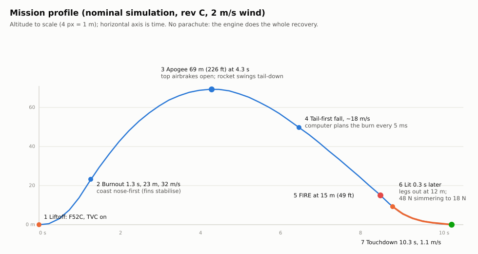
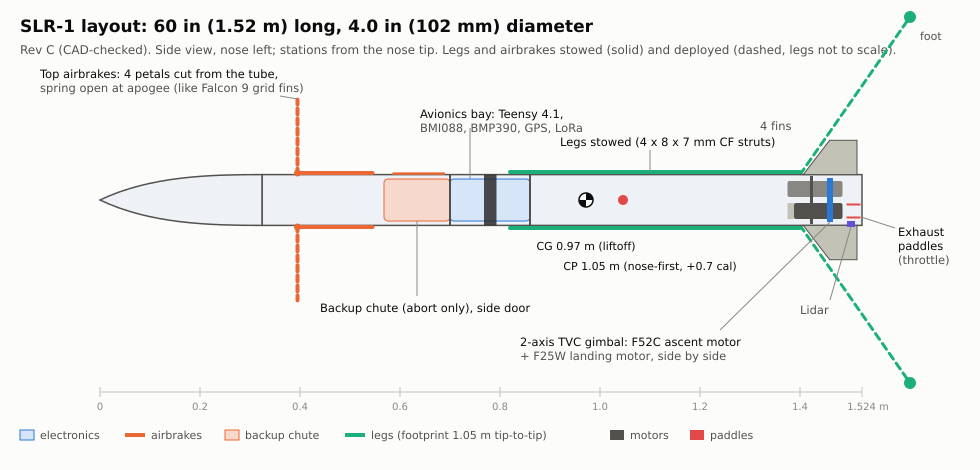

# Self-Landing Rocket (SLR-1)

A complete design package for a **5 ft (1.52 m) hobby rocket** that:

- launches to **~500 ft**,
- falls back, **lights a throttled, thrust-vectored motor near the ground and
  catches itself**,
- **flips its landing legs down** just before touchdown, and
- lands upright.



## The design in one paragraph

SLR-1 is a 4 in x 60 in rocket, 1.39 kg at liftoff.

- **Motors:** two AeroTech G40W, side by side in one 2-axis thrust-vector
  (TVC) gimbal.
- **Ascent:** one motor flies it to 152 m (498 ft), with small fins keeping it
  stable while it coasts up with the motor out.
- **Descent:** at apogee a 9 in drogue pops from the nose. The rocket falls
  tail-first, stable, at a steady ~22.5 m/s.
- **Landing burn:** the flight computer fires the second motor at about 21 m.
  Solid motors can't be throttled, so **two ceramic paddles swing into the
  exhaust** to waste up to 75% of the thrust. The computer re-plans the
  throttle 50 times a second while the gimbal holds the rocket upright and
  kills sideways drift.
- **Touchdown:** legs spring down at 8 m and the rocket touches down at ~1.2 m/s.
- **Fail-safe:** a backup parachute covers every failure case.



| | |
|---|---|
| Liftoff mass | 1387 g (model-rocket limit 1500 g) |
| Propellant | 107.6 g (limit 125 g); total impulse 198 N·s → **FAA Class 1 model rocket, no certification needed** |
| Apogee | 152 m / 498 ft (Monte Carlo p5-p95: 138-169 m) |
| Touchdown | 1.2 m/s nominal; Monte Carlo mean 1.5 m/s, p95 2.3 m/s |
| Monte Carlo (300 flights) | **90% clean landings, 0 crashes**; 100% in wind < 2 m/s |
| Est. cost | ≈ $2,100 including 12 motors, test gear and spares |

## What's in this repo

| Path | What |
|---|---|
| [`docs/01-mission-and-architecture.md`](docs/01-mission-and-architecture.md) | Mission, requirements, trade study, **why this architecture** |
| [`docs/02-regulations-and-safety.md`](docs/02-regulations-and-safety.md) | FAA Part 101, NAR/Tripoli/NFPA, Massachusetts, clubs, safety rules |
| [`docs/03-vehicle-design.md`](docs/03-vehicle-design.md) | Geometry, **mass budget**, stability nose-first *and* tail-first, materials |
| [`docs/04-propulsion.md`](docs/04-propulsion.md) | Motor selection, **exhaust-paddle throttle**, dual-motor TVC gimbal, ignition |
| [`docs/05-avionics.md`](docs/05-avionics.md) | Flight computer, sensors, **pyro circuit**, power, pin map |
| [`docs/06-gnc.md`](docs/06-gnc.md) | State machine, estimation, TVC control, **landing guidance math**, simulation results |
| [`docs/07-landing-legs.md`](docs/07-landing-legs.md) | Leg geometry, tip-over analysis, flip-down mechanism, damping |
| [`docs/08-build-guide.md`](docs/08-build-guide.md) | **Step-by-step build procedure** |
| [`docs/09-test-plan.md`](docs/09-test-plan.md) | Development ladder: bench → static fires → ascent-only → "virtual ground" → full landing |
| [`docs/10-flight-ops.md`](docs/10-flight-ops.md) | **Printable checklists**, go/no-go, misfire and abort procedures |
| [`docs/11-bom-and-budget.md`](docs/11-bom-and-budget.md) | Bill of materials and cost |
| [`docs/12-references.md`](docs/12-references.md) | Sources |
| [`sim/`](sim/) | Python 3-DOF mission simulator + Monte Carlo ([README](sim/README.md)) |
| [`firmware/`](firmware/) | Teensy 4.1 flight software ([README](firmware/README.md)) |

## Quick start

```bash
# simulator (Python 3.10+, numpy, matplotlib)
pip install numpy matplotlib
python sim/scripts/mass_budget.py          # mass, CG, static margins
python sim/scripts/run_nominal.py          # one flight + plots in docs/img/
python sim/scripts/run_montecarlo.py 300   # dispersion campaign
python sim/scripts/ignition_sensitivity.py

# flight software
make -C firmware test            # native unit tests + full-mission SIL (C++ vs Python goldens)
make -C firmware compile-check   # type-check the Teensy build against stub headers
cd firmware && pio run -e teensy41   # real build (PlatformIO)
```

## Status and honest caveats

- **This is a design, a simulator and flight software. Nothing has been
  built or flown, and the firmware has not run on real hardware yet.**
- The simulated success rate depends on assumptions that **you must replace
  with measurements**, following [docs/09](docs/09-test-plan.md):
  - landing-motor ignition delay (assumed 0.30 ± 0.08 s);
  - paddle throttle authority (assumed to cut 75% of thrust);
  - final mass and inertia.
- Read [docs/02](docs/02-regulations-and-safety.md) before buying motors.
- Fly only at a club launch, with RSO approval and the backup parachute
  installed.
