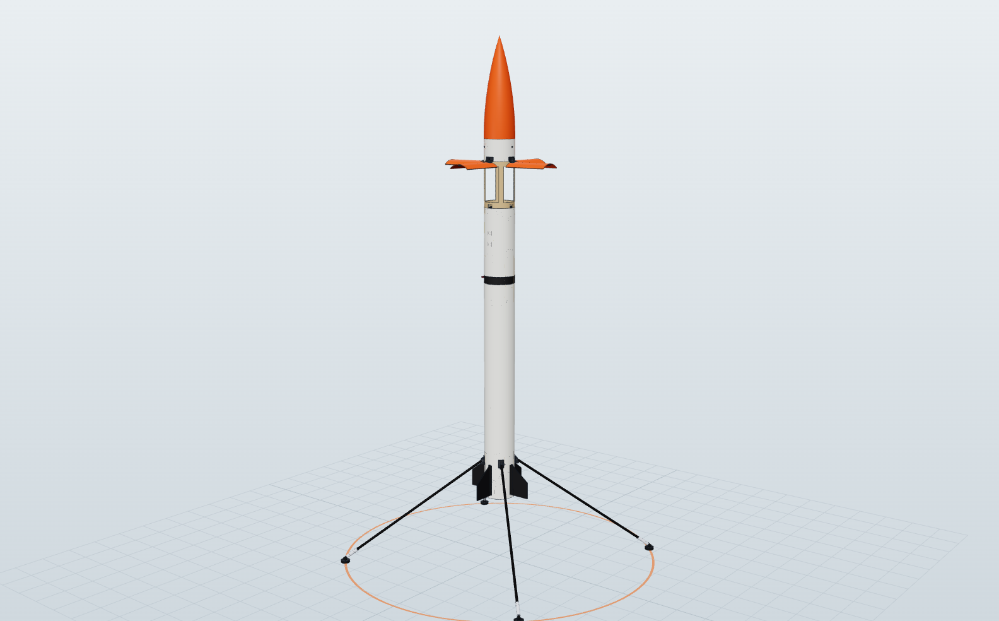

# Self-Landing Rocket (SLR-1)

A complete design package for a **5 ft (1.52 m) hobby rocket**. A solid motor
shoots it to **~200 ft**. On the way down, a second, thrust-controlled motor
**catches it**: braking hard at first, then simmering down to about the
rocket's weight. **Landing legs flip down** before an upright touchdown.
**No parachute is used in a normal flight. The engine does the recovery.**




## The design in one paragraph

SLR-1 is a 4 in x 60 in rocket weighing 1.47 kg at liftoff. **Rev C is
CAD-checked**: every part is modelled in 3D ([`cad/`](cad/), [docs/13](docs/13-cad.md)),
and the simulator uses the CAD's mass, CG and inertia. [docs/14](docs/14-sections.md)
walks through the rocket section by section, with X-ray views and a numbered
card for each of the 133 parts.

- **Motors:** two single-use AeroTech F motors share one 2-axis gimbal that
  steers the thrust (TVC): an **F52C** for the climb and an **F25W** for the
  landing.
- **Climb:** the F52C flies it to **69 m (226 ft)**. Small fins keep it pointed
  while it coasts up with the motor out.
- **Fall:** at apogee, four airbrake petals cut from the body tube spring open
  near the top, like Falcon 9's grid fins. They keep the rocket tail-down and
  falling straight at ~18 m/s.
- **Landing burn:**
  - The flight computer lights the F25W at about 15 m (49 ft).
  - Two ceramic paddles in the exhaust **throttle** it. The computer plans a
    burn that starts strong and fades out exponentially, so thrust tapers from
    ~48 N to ~18 N (the rocket weighs 13.8 N) at touchdown.
  - The gimbal holds it upright and cancels sideways drift.
- **Touchdown:** the legs flip down at 12 m and it lands at ~1.1 m/s.
- **Backup chute:** fires only if the landing motor fails to light.


| | |
|---|---|
| Liftoff mass | 1472 g from the CAD (model-rocket limit 1500 g: **28 g margin**) |
| Motors | AeroTech F52C (climb) + AeroTech F25W (landing), both single-use |
| Propellant / total impulse | 68.8 g / 137 N·s → **FAA Class 1 model rocket, no certification, 1000 ft field** |
| Apogee | 69 m / 226 ft (Monte Carlo p5-p95: 62-77 m) |
| Landing burn | lit ~15 m up, ~1.5 s long, thrust 48 N → 18 N ("strong, then simmer") |
| Touchdown | 1.1 m/s nominal; Monte Carlo mean 1.4 m/s, p95 2.0 m/s |
| Monte Carlo (300 flights) | **93% clean landings, 7% hard but intact, 0 crashes**; 94-99% in wind under 3 m/s |
| CAD | 133 parts, 219 pieces; STEP for SolidWorks, STL for printing, DXF for laser cutting; 0 clashes |
| Est. cost | ≈ $1,800 including motors, test gear and spares |

## What's in this repo

| Path | What |
|---|---|
| [`docs/01-mission-and-architecture.md`](docs/01-mission-and-architecture.md) | Mission, requirements, trade study, **why this architecture** |
| [`docs/02-regulations-and-safety.md`](docs/02-regulations-and-safety.md) | FAA Part 101, NAR/Tripoli/NFPA, Massachusetts, clubs, safety rules |
| [`docs/03-vehicle-design.md`](docs/03-vehicle-design.md) | Geometry, **mass budget**, stability nose-first *and* tail-first, airbrakes, materials |
| [`docs/04-propulsion.md`](docs/04-propulsion.md) | Motor selection, **exhaust-paddle throttle**, dual-motor TVC gimbal, ignition |
| [`docs/05-avionics.md`](docs/05-avionics.md) | Flight computer, sensors, **pyro circuit**, power, pin map |
| [`docs/06-gnc.md`](docs/06-gnc.md) | State machine, estimation, TVC control, **"strong then simmer" landing guidance**, simulation results |
| [`docs/07-landing-legs.md`](docs/07-landing-legs.md) | Leg geometry, tip-over analysis, flip-down mechanism, damping |
| [`docs/08-build-guide.md`](docs/08-build-guide.md) | **Step-by-step build procedure** |
| [`docs/09-test-plan.md`](docs/09-test-plan.md) | Development ladder: bench → static fires → ascent-only → "virtual ground" → full landing |
| [`docs/10-flight-ops.md`](docs/10-flight-ops.md) | **Printable checklists**, go/no-go, misfire and abort procedures |
| [`docs/11-bom-and-budget.md`](docs/11-bom-and-budget.md) | Bill of materials and cost |
| [`docs/12-references.md`](docs/12-references.md) | Sources |
| [`docs/13-cad.md`](docs/13-cad.md) | **3D CAD model**: files, opening it in SolidWorks, making the parts, what the CAD changed |
| [`docs/14-sections.md`](docs/14-sections.md) | **Section by section**: X-ray views of each bay with every part numbered and explained |
| [`cad/`](cad/) | Parametric CadQuery model + generated STEP / STL / DXF / BOM in [`cad/out/`](cad/out/) ([README](cad/README.md)) |
| [`sim/`](sim/) | Python 3-DOF mission simulator + Monte Carlo ([README](sim/README.md)) |
| [`firmware/`](firmware/) | Teensy 4.1 flight software ([README](firmware/README.md)) |

## Quick start

```bash
# simulator (Python 3.10+, numpy, matplotlib)
pip install numpy matplotlib
python sim/scripts/mass_budget.py          # mass, CG, static margins
python sim/scripts/run_nominal.py          # one flight + plots in docs/img/
python sim/scripts/run_montecarlo.py 300   # dispersion campaign
python sim/scripts/ignition_sensitivity.py

# CAD (CadQuery 2.8): STEP, STL, DXF, BOM, mass report, clash checks
pip install cadquery
python cad/build.py

# flight software
make -C firmware test            # native unit tests + full-mission SIL (C++ vs Python goldens)
make -C firmware compile-check   # type-check the Teensy build against stub headers
cd firmware && pio run -e teensy41   # real build (PlatformIO)
```

## Status and honest caveats

- **This is a design, a simulator and flight software. Nothing has been
  built or flown, and the firmware has not run on real hardware yet.**
- The simulated success rate rests on assumptions you must replace with
  measurements, following [docs/09](docs/09-test-plan.md):
  - landing-motor ignition delay (assumed 0.30 ± 0.08 s);
  - paddle throttle authority;
  - airbrake drag;
  - final mass and inertia: the CAD puts the rocket only 28 g under the
    1500 g limit, so weigh every part as you build.
- Read [docs/02](docs/02-regulations-and-safety.md) before buying motors.
- Fly only at a club launch, with RSO approval and the backup parachute
  installed.
- Earlier designs, kept in git history:
  - rev A: 500 ft on two G40W motors with a drogue (still selectable with
    `slr1(drag_device="drogue", ascent="AeroTech_G40W", landing="AeroTech_G40W")`);
  - rev B: the same airframe as rev C on an F42T, with a paper mass budget of 1314 g.
    The CAD showed it was about 150 g heavier.
