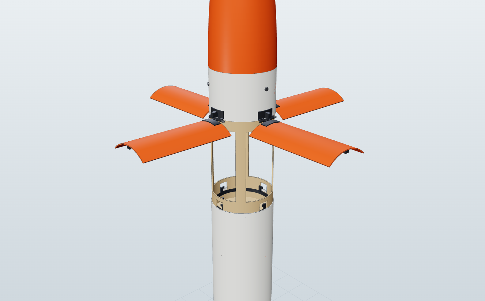

# 3. Vehicle design (airframe, mass, stability)


**Rev C is CAD-checked.** Every part below is modelled in 3D in [`cad/`](../cad/)
([docs/13](13-cad.md)): 129 parts, no clashes, gimbal free through ±7°. The
CAD replaced the earlier paper estimates. The rocket turned out about 150 g
heavier than the rev B budget, so rev C trims weight, moves to the F52C ascent
motor, and re-balances the fins and airbrakes.


## 3.1 Geometry

| Item | Value |
|---|---|
| Overall length | 60 in (1.524 m) |
| Body | LOC Precision 3.9 in kraft tube (3.9 in ID / 4.0 in OD, 0.05 in wall), **47.25 in** in total, cut into 5 pieces (§3.5) |
| Nose | 3D-printed PETG tangent ogive: 12.75 in exposed + 2 in shoulder, held by 3 × M3 screws so it comes off for access to the airbrake latch |
| Top airbrakes | 4 petals cut from the body tube between stations 0.395 and 0.545 m (150 mm long, one quadrant each, ~80 mm wide), hinged at the forward edge |
| Backup chute bay | Stations 0.568-0.700 m; side door 105 x 70 mm at 90° (fin 2 side) |
| Avionics bay | 160 mm coupler at stations 0.70-0.86 m, joined by a 25 mm switch band at 0.768-0.793 m |
| Fins | 4 x 3/32 in aircraft birch ply: root 4.23 in, tip 2.16 in, span 2.70 in, sweep 2.07 in (90 % of the rev B fin); trailing edge 10 mm forward of the aft end |
| Legs | 4 x 8 x 7 mm carbon tube, hinged at station 1.40 m, deploying to 55° for a 1.05 m tip-to-tip footprint; feet 220 mm below the aft end |
| Motors | AeroTech F52C (29 x 111 mm, ascent) + AeroTech F25W (29 x 98 mm + 13 mm spacer, landing), side by side in one gimbal, 33 mm centre-to-centre |
| Gimbal pivot | Station 1.46 m, at the middle of the 113 mm motor sleeves |

**Why 4 inches?** Two 29 mm motors side by side, plus ±7° of gimbal swing,
need an envelope of about 85 mm. A 3 in tube is only 76 mm inside. The CAD
sweep shows the sleeves clear the aft liner by 4 mm at full deflection.

## 3.2 Mass budget (target: ≤ 1500 g at liftoff)

Rolled up from the CAD by `python cad/build.py` (full report:
[`cad/out/mass_report.md`](../cad/out/mass_report.md)) and mirrored in
`sim/rocketsim/designs.py`. Made parts are CAD volume x material density;
bought parts use catalogue or estimated masses. **Replace every line with a
scale reading as you build.**

| Item | CAD (g) | Station (m) | Rev B paper budget (g) |
|---|---:|---:|---:|
| Nose cone (PETG, 0.8 mm wall) + 2 in shoulder | 99 | 0.24 | 95 |
| Top airbrakes: hinges, springs, tabs, latch ring + servo | 16 | 0.45 | 35 |
| Backup chute (30 in), Nomex, shock cord, ejector, door hardware + servo | 97 | 0.63 | 85 |
| Avionics: Teensy 4.1, BMI088, BMP390, GPS, LoRa, 2S 450 mAh, switches | 112 | 0.77 | 105 |
| Couplers, bulkheads, sled, aft carbon liner, thrust plate, leg doublers | 250 | 0.86 | 80 |
| Body tube: 47.25 in of LOC 3.9 in kraft (incl. the petals and door) | 402 | 0.92 | 374 |
| 4 landing legs (8 x 7 CF, dampers, TPU feet, clevises) + release servo | 101 | 1.09 | 85 |
| Wiring harness, cables, screws, epoxy fillets | 38 | 1.13 | 45 |
| Dual-motor TVC gimbal: rings, posts, sleeves, 2 servos, pushrods | 94 | 1.43 | 130 |
| 4 fins (3/32 in ply) | 37 | 1.47 | 45 |
| Exhaust-paddle throttle: ceramic paddles, arms, bracket, servo | 33 | 1.49 | 50 |
| Lidar + bracket + window | 10 | 1.50 | 12 |
| **Dry total** | **1288** | **CG 0.908** | 1141 |
| AeroTech F52C (ascent) | 81 | 1.43 | (F42T 76) |
| AeroTech F25W (landing) | 97 | 1.44 | 97 |
| **Liftoff** | **1467** | **CG 0.972** | 1314 |

- **Margin:** **33 g** to the 1500 g model-rocket limit. That is thin: weigh
  every part, and use the lightening options below if the build runs heavy.
- **Pitch inertia:** 0.246 kg·m² at liftoff (CAD). **Measure it** with a
  bifilar pendulum before tuning the TVC.
- **Where the paper budget was wrong:**
  - the couplers, bulkheads and avionics-bay hardware weigh about 250 g, not 80 g;
  - 60 in overall needs 47.25 in of body tube, not 43.5 in;
  - the legs come to about 100 g even with thin-wall struts.
- **Rev C weight cuts already in the CAD:**
  - shorter, windowed airbrake sleeve;
  - 0.5 mm carbon liner instead of a 6 in coupler;
  - single-disc avionics lids;
  - nylon threaded rods;
  - lite-ply sled;
  - kraft motor sleeves;
  - 8 x 7 mm struts;
  - 3/32 in fins;
  - 2 in nose shoulder.
- **More lightening if you are over:**
  - a 2S 300 mAh pack (-10 g);
  - a GPS module with an on-board antenna (-9 g);
  - 1 mm PCB instead of perfboard (-7 g);
  - a 130 mm avionics bay (-14 g).

## 3.3 Stability: coasting up and falling down

With the motor off, the gimbal can't steer. So the airframe must be passively
stable in **both** directions:

| Phase | Flow direction | What keeps it straight | Static margin (calibers) |
|---|---|---|---|
| Boost (motor on) | nose-first | TVC + fins | +0.73 |
| Coast up (motor off, ~3 s) | nose-first | **fins** | **+0.82** |
| Fall, airbrakes closed | tail-first | nothing: fins at the leading end destabilise | **−4.88** (tumbles) |
| Fall, airbrakes open (~4 s) | tail-first | **top airbrakes** | **+1.00** |
| Landing burn | tail-first, slowing | TVC + airbrakes | (active) |

**Why airbrakes at the top work.**
- The rocket is tail-heavy: the motors, gimbal and legs are aft, putting the
  CG at 0.97 m of 1.52 m.
- A tail-heavy body falls like a shuttlecock only if there is drag behind it,
  at the top.
- Falcon 9 gets that from grid fins at the top of the stage. SLR-1 gets it
  from four petals that are part of the tube until apogee, then spring out
  to 90°.

They also set a steady **~19 m/s** fall. That is ideal for the F25W, and the
burn always starts from about the same state.

**Why rev C changed the fins and petals.** The real CG sits 4.5 cm further
forward than the paper budget said. That raised the nose-first margin to +1.2
but cut the tail-first margin under airbrakes to +0.07. On the F42T, 19 % of
simulated flights then aborted to the backup chute; on the F52C, 2 % crashed.
Fins at 90 % and petals lengthened from 125 to 150 mm put both margins back
near +0.8 to +1.0.

The CP model is component build-up:
- **Nose cone:** Barrowman ogive, CNα = 2, only when it leads the flow.
- **Blunt aft end:** CNα ≈ 1 when it leads.
- **Fins:** Barrowman, the same in both directions.
- **Airbrakes:** flat plates, C_d·S/A = 7.1 at 0.405 m.
- **Body:** viscous crossflow.

The model is in `sim/rocketsim/vehicle.py`. Background:
[Nakka](https://www.nakka-rocketry.net/RD_Appendix_B.html),
[OpenRocket tech doc](https://openrocket.sourceforge.net/techdoc.pdf).
OpenRocket assumes nose-first flight, so use it for mass, CG and drag only.

**The simulator's trade study** (Monte Carlo, 150-300 flights each):

| Configuration | Result |
|---|---|
| Finless, with or without airbrakes | tumbles on the coast up: 0% |
| Rev B fins and 125 mm petals at the CAD mass | tail-first margin +0.07: 85% clean, 2% crash |
| **90 % fins + 150 mm petals (rev C baseline)** | **93% clean, 0 crashes** |

### Terminal velocity check

v_t = sqrt(2 m g / (ρ C_d A)), with the 1.44 kg descent mass:

- **Airbrakes closed:** C_A ≈ 1.07, A = 8.1e-3 m² → ~52 m/s.
- **Airbrakes open:** C_d·A = 0.066 m² → **~19 m/s**. The simulator gives
  18.2 m/s at the fire point after a 54 m fall.

## 3.4 Top airbrake petals



```
   stowed (part of the tube)            open at apogee (springs, 90 deg stop)
   ===|=======|=========                ===|        |=========
      | petal |                            |petal   |
   ===|=======|=========                      \  (sticks out 150 mm into the airflow)
     hinge (forward edge)
```

- **Cut:** cut a 150 mm band of the body tube at 0.395-0.545 m into four 90°
  quadrants (~80 mm arc each), with the cut lines on the leg lines. Each petal
  keeps the tube's curvature, so it sits flush when stowed.
- **Hinges:** a printed CF-nylon hinge on the forward edge of each petal (a
  fixed half on the nose ring, a moving half on the petal), with a 1.6 mm
  stainless pin.
- **Springs:** a torsion spring per petal, ~0.1 N·m preload.
- **Stop:** a printed stop at 90° on the fixed hinge half. Make it stiff,
  because the petals take the full dynamic pressure at 19 m/s, about 210 Pa or
  3 N per petal.
- **Latch:** a printed ring inside the sleeve with one finger per petal. Each
  finger sits in a notch on a tab bonded inside the petal's aft edge. One
  micro servo (`SERVO_AIRBRAKE_LATCH`, pin 7) turns the ring.
- **Opening:** at apogee the servo turns the ring and the petals spring open
  in < 0.2 s.
- **Structure:** a 189 mm coupler sleeve sits behind the petals. It is glued
  19 mm into the nose ring and 20 mm into the recovery section, so the
  airframe keeps its strength. The sleeve has a lightening window under each
  petal, which saves 33 g.
- **Upgrade path:** servo-driven petals, or real 3D-printed grid fins, could
  *steer* the fall like Falcon 9. That needs 2-4 more servos.

## 3.5 Structure and materials

| Part | Material | Notes |
|---|---|---|
| Body tube | LOC kraft 3.9 in, 0.05 in wall (~103 g/ft) | Cut five pieces: nose ring 71 mm, petal band 150 mm, recovery section 223 mm, switch band 25 mm, aft tube 731 mm ([LOC tubes](https://locprecision.com/products/cardboard-airframes)) |
| Airbrake petals | Cut from the tube; edges sealed with thin CA; inner face stiffened with one layer of 2 oz fibreglass | |
| Airbrake sleeve, avionics bay | LOC 3.9 in couplers (189 mm windowed; 160 mm) | |
| Aft reinforcement | 6 in carbon liner: 2 wraps of 200 gsm cloth + epoxy inside the aft tube | Backs the fin slots, leg hinges and thrust plate; 35 g instead of 67 g for a coupler |
| Nose | PETG, 0.8 mm walls, 1.2 mm shoulder | |
| Bulkheads, lids, plates | 1/8 in birch ply (recovery bulkhead, avionics lids, thrust plate + 1 mm aluminium) | Lids key into the coupler with a printed ring |
| Avionics sled | 1/8 in lite ply on 2 nylon M3 rods | |
| Gimbal | CF-nylon printed rings and posts, **kraft 29 mm motor sleeves** with high-temperature epoxy, aluminium thrust caps, 3 mm steel pins | PLA softens at ~60 °C, so don't use it near the motor ([PETG vs PLA](https://www.makeitfrom.com/compare/Glycol-Modified-Polyethylene-Terephthalate-PETG-PET-G/Polylactic-Acid-PLA-Polylactide)) |
| Motor retention | Spring-steel clip on each sleeve | Screw-cap retainers are wider than the 33 mm motor spacing |
| Paddles | Machinable ceramic (alumina-silicate) or graphite on stainless arms, aluminium bracket | Inspect after every burn ([The New Stack](https://thenewstack.io/one-mans-dream-to-build-a-working-spacex-style-model-rocket/)) |
| Fins | 3/32 in aircraft birch ply, 6 mm epoxy fillets | Through-the-wall to the liner |
| Legs | 8 x 7 mm carbon tube, printed hinge clevises, syringe dampers, TPU feet | See [docs/07](07-landing-legs.md) |
| Adhesive | 30-minute epoxy (or West System 105/206 + 406) for structure; high-temperature epoxy near the motors | |

## 3.6 Launch hardware

- **Pad:** a flat steel blast plate with a short guide or launch clamp. Clear
  this with the RSO ([docs/02](02-regulations-and-safety.md)).
- **Landing pad (optional):** a 2 x 2 m plywood sheet gives the feet and the
  lidar a flat, reflective target.
