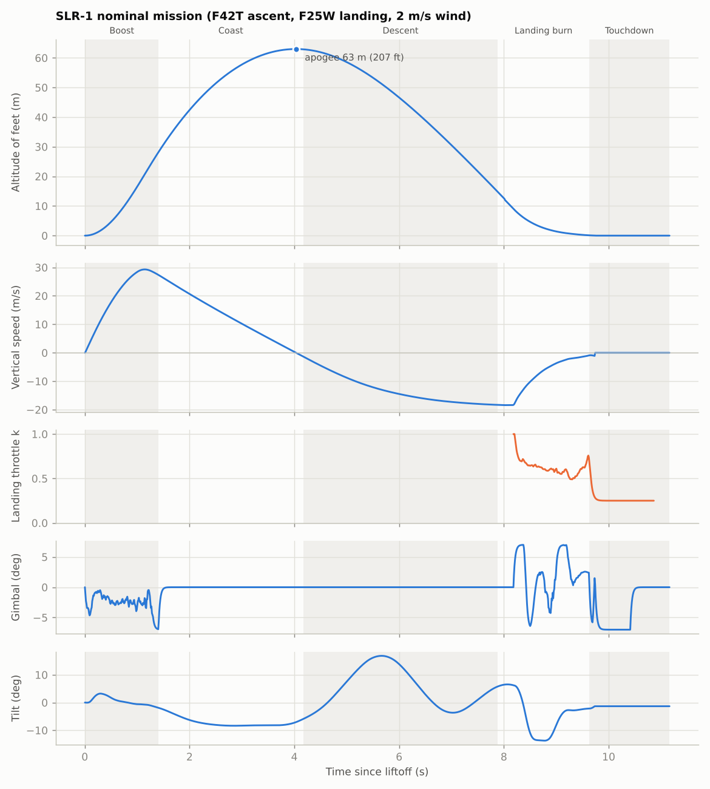
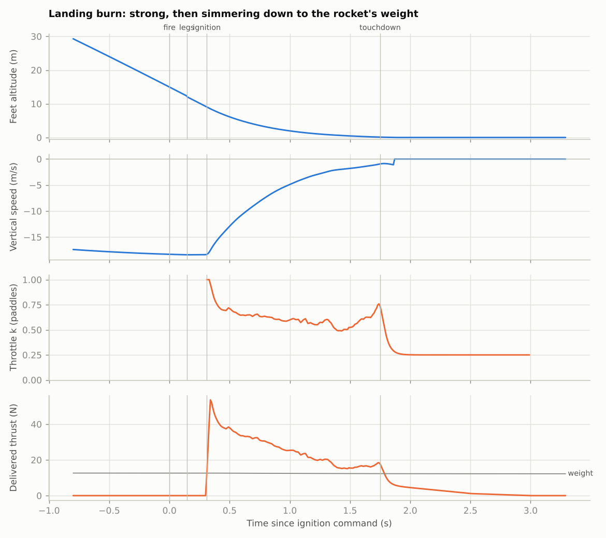
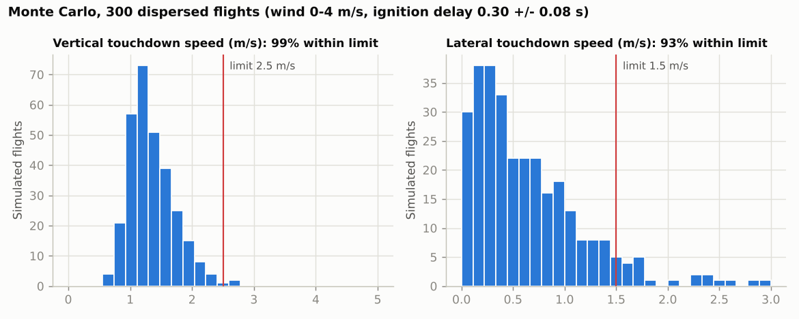
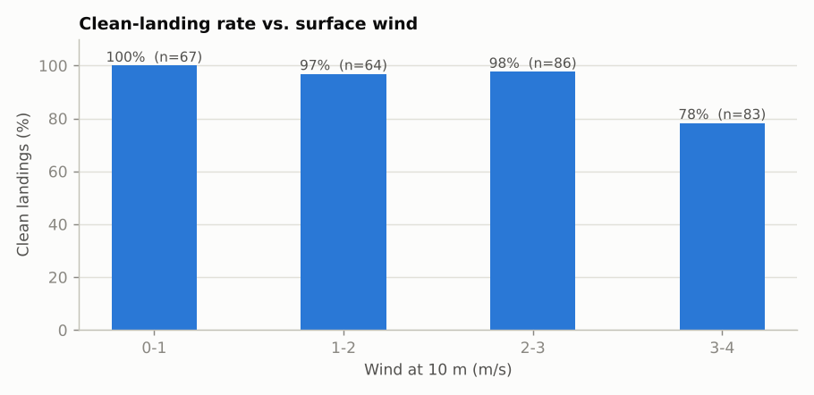
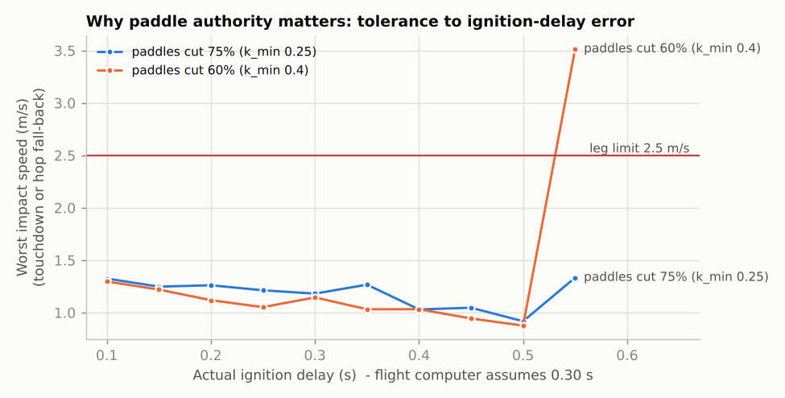

# 6. Guidance, navigation and control

The same algorithms exist twice:
- `sim/rocketsim/guidance.py` (Python, used by the simulator), and
- `firmware/src/core/` (C++, flown).

`make -C firmware test` checks that the C++ reproduces the Python numbers and
flies full software-in-the-loop missions through the real C++ state machine.
The Python numbers live in `firmware/test/native/golden.h`, generated by
`firmware/tools/gen_tables.py`.

## 6.1 State machine

```
PAD_SAFE ──(key in, calibrated, vertical < 5°, continuity A & B)──> PAD_ARMED
PAD_ARMED ──(key out)──> PAD_SAFE
PAD_ARMED ──(axial accel > 2 g for 50 ms)──> BOOST          TVC on (ascent curve, 2.1° offset trim)
BOOST ──(axial accel < 0 for 25 ms, t > 0.3 s)──> COAST     gimbal centred, fins keep it pointed
COAST ──(KF velocity < -0.5 m/s for 50 ms)──> DESCENT       top airbrakes spring open
DESCENT ──(guidance says FIRE and envelope OK)──> LANDING_BURN   both igniters, 1 s pulse
DESCENT ──(tilt > 35° below 70% of apogee) or (h < 15 m and outside envelope)──> ABORT_CHUTE
LANDING_BURN ──(no thrust 0.9 s after FIRE)──> ABORT_CHUTE
LANDING_BURN ──(h_feet <= 5 cm)──> TOUCHDOWN    paddles closed, attitude hold until burnout
TOUCHDOWN ──(burnout + 2 s)──> LANDED_SAFE      pyro disabled, log written to SD
```

No parachute is involved in a normal flight. `ABORT_CHUTE` is the only path
that deploys one.

## 6.2 Navigation (state estimation)

**Attitude.** A gyro-integrated quaternion, q̇ = ½ q ⊗ [0, ω − b].

- On the pad the vehicle is still, so the accelerometer gives the initial
  attitude (a 3 s average) and the gyro bias b.
- In flight the accelerometer is not a gravity reference: it reads thrust and
  drag. So attitude runs on the gyros alone for the ~10 s flight
  ([RocketFC](https://github.com/trooper7652-commits/RocketFC) reports ~0.45°
  of drift over a 3.45 s burn).
- Madgwick ([doi:10.1109/ICORR.2011.5975346](https://doi.org/10.1109/ICORR.2011.5975346))
  and Mahony ([doi:10.1109/TAC.2008.923738](https://doi.org/10.1109/TAC.2008.923738))
  filters only help on the pad.

**Altitude and vertical speed.** A 3-state Kalman filter, x = [h, v, b_a]:

- **Predict** at 1 kHz with the world-frame vertical specific force.
- **Barometer** updates at 50 Hz, σ = 0.5 m (3 m during burns). 5σ outliers
  are rejected.
- **Lidar** updates when the range is < 10 m and the tilt is < 30°:
  h = r·cos θ, σ = 6 cm.
- **Zero-velocity** updates on the pad and after landing.
- Modelling the accelerometer bias matters: an unmodelled bias drove the
  velocity estimate to zero ~1 s early in one study
  ([Rice thesis](https://repository.rice.edu/server/api/core/bitstreams/0fbefe49-d831-4891-b83f-d8c2f05ce2f9/content)).

**Horizontal velocity.** The world-frame accelerometer is integrated at 1 kHz
and corrected toward GPS NED velocity (gain 0.2 at 10 Hz). The pad heading of
fin 1 (`PAD_HEADING_DEG`) rotates the GPS frame into the attitude frame.

## 6.3 TVC attitude control (dynamic-inversion PID)

A thrust T deflected by small angles (δ_y, δ_z) at a lever L aft of the CG,
with the motor offset e along body y, gives body torques

τ_y = L·T·sin δ_z,   τ_z = −L·T·sin δ_y − e·T.

The controller picks a desired angular acceleration and inverts that relation
**using the current thrust**, so the loop bandwidth stays the same as thrust
rises and falls:

α_des = ω_n²·e_att − 2ζω_n·ω + K_i∫e_att,   sin δ_z = I·α_y / (L·T),
sin δ_y = −I·α_z / (L·T) − e/L.

- **Gains:** ω_n = 12 rad/s, ζ = 0.85, K_i = 4.
- **Anti-windup:** conditional integration, reset at each ignition.
- **Gimbal:** ±7°, centred below 1 N of thrust.
- **Roll:** uncontrolled; working in the body frame handles it.

## 6.4 Landing guidance: "strong, then simmer"

The burn is planned as a **net upward acceleration that decays
exponentially**:

a(s) = A·e^(−s/τ) + C,    s = time since now, s ∈ [0, T],   T = t_land − t_burn.

A large A means hard braking at the start; τ sets how fast it fades. Requiring
**h(T) = 0** and **v(T) = −0.5 m/s** gives two linear equations in A and C:

```
v_T:  A·τ(1 − e^(−T/τ)) + C·T            = −v_td − v
h_T:  A·τ(T − τ(1 − e^(−T/τ))) + ½·C·T²  = −h − v·T
```

The throttle that produces that acceleration, given the known thrust curve
T_motor(t), the mass m(t) and the drag D(v), is

k(s) = m·(a(s) + g − D/m) / (s_thrust · T_motor(t_burn + s) · cos θ),   clipped to [k_min, 1],

where s_thrust is the thrust scale learned in flight from the accelerometer.

**Each re-plan (50 Hz):**
- **Touchdown window:** t_land must be in [t1, t2], where k_min·T_motor < W
  (no post-touchdown hop) and T_motor > 1.25·W (enough thrust left to stop).
  For the F25W: **[0.40 s, 1.79 s]**.
- **Search:** 9 touchdown times x 3 decay rates (τ = 0.25, 0.35 and 0.5 of T)
  are tried.
- **Score:** each candidate is scored on any throttle outside [k_min, 1], plus
  how far its **net acceleration at touchdown is from zero**, i.e. how close
  it ends to a hover (thrust + drag ≈ weight). That last term is what makes it
  "simmer".
- **Command:** the best plan's k(0).

**When to fire.**
- While falling, the computer predicts the state at ignition by coasting
  through the expected ignition delay with the airbrakes' drag.
- It solves a linear throttle-ramp plan that lands 65% of the way into the
  window, and **fires when that ramp becomes flat (k1 ≤ 0)**.
- That point sits inside the feasible ignition band with room either side for
  early or late ignition.
- Nominal fire altitude at 18.5 m/s: **15.0 m**, the same in the Python and
  the C++.

**Terminal phase (h < 0.8 m):** constant-deceleration braking to 0.5 m/s at
h = 0.

**Lateral:** lean the *thrust* by φ = clip(−1.5·v_h/g, ±12°), faded to zero
below 2.5 m so the rocket arrives upright. The body leans by φ minus the
offset trim.

**What it looks like in flight** (nominal simulation):

| Time after ignition | 0.05 s | 0.25 s | 0.5 s | 0.75 s | 1.0 s | 1.25 s | touchdown 1.4 s |
|---|---|---|---|---|---|---|---|
| Delivered thrust (N) | 49 | 35 | 30 | 24.5 | 20 | 16 | ~16 |
| Rocket weight (N) | 12.6 | 12.6 | 12.5 | 12.4 | 12.4 | 12.3 | 12.3 |
| Descent speed (m/s) | 16.8 | 11.5 | 7.2 | 4.3 | 2.4 | 1.6 | 1.1 |
| Height (m) | 8.2 | 5.4 | 3.1 | 1.7 | 0.85 | 0.35 | 0 |

This is a cut-down cousin of real powered-descent guidance. Further reading:

- Açıkmeşe & Ploen 2007, [doi:10.2514/1.27553](https://doi.org/10.2514/1.27553)
- Blackmore, Açıkmeşe & Scharf 2010, [doi:10.2514/1.47202](https://doi.org/10.2514/1.47202)
- Scharf et al. (G-FOLD on Masten Xombie), [doi:10.2514/1.G000399](https://doi.org/10.2514/1.G000399)
- Blackmore, NAE Frontiers 2016, [doi:10.17226/23659](https://doi.org/10.17226/23659)
- Malyuta et al. review, [arXiv:2108.02335](https://arxiv.org/abs/2108.02335)

## 6.5 Simulation (sim/)

**The model.** Planar 3-DOF (x, z, pitch) with:

- real thrust curves; mass and CG that change as propellant burns;
- component aerodynamics valid for nose-first and tail-first flow;
- deployable airbrakes; a backup chute;
- servo lag and rate limits; paddle-throttle lag;
- wind (1/7 power law + gusts); sensor noise and biases;
- ground contact with hop detection.

The flight computer in the loop is the Python twin of the firmware.

**Nominal flight** (`run_nominal.py`):




**Monte Carlo** (`run_montecarlo.py`, 300 flights). Dispersions:

- ignition delay 0.30 ± 0.08 s
- impulse and burn time ±3%
- k_min 0.25 ± 0.03, throttle gain ±3%
- C_d ±10%, mass ±2%
- wind 0-4 m/s
- launch tilt 1°, thrust misalignment 0.25°
- altitude bias 15 cm, gyro bias 0.05°/s

| Metric | Result |
|---|---|
| Clean landings (≤ 2.5 m/s vertical, ≤ 1.5 m/s lateral, ≤ 10° tilt, hop ≤ 0.3 m) | **278 / 300 (93%)**; the other 22 are hard landings; **0 crashes** |
| Vertical touchdown | mean 1.35 m/s, p95 2.02 m/s, max 2.65 m/s |
| Lateral touchdown | p5-p95 −1.16 to +1.47 m/s (the main failure driver) |
| Apogee | mean 63 m (208 ft); p5-p95 57-71 m |
| Landing spot | p5-p95 −19 to +22 m from the pad |
| Wind 0-1 / 1-2 / 2-3 m/s | 100% / 97% / 98% clean |
| Wind 3-4 m/s | 78% → **fly landing attempts below 3 m/s** |
| Weak paddles (k_min 0.40) | 93% |
| Linear-ramp guidance instead of "strong then simmer" | 89% |





**What the simulation does not capture:**
- 3-D coupling and roll;
- airbrake opening dynamics and their real drag;
- plume effects on the paddles;
- lidar dropouts;
- structural flexibility.

Treat the 93% as "the design closes on paper with these assumptions".
**Re-run the Monte Carlo with your measured numbers.**

## 6.6 Tuning order

1. Gimbal linkage calibration, then `IMU_MAP`. Check signs on the bench.
2. Measure mass, CG and inertia → `params.h` and `designs.py`.
3. Static fires → ignition delay, thrust scale, k_min → `params.h`, then re-run
   the Monte Carlo.
4. Flight F1 (ascent only) → measured airbrake descent speed → `CDA_PRE_M2`.
5. Attitude gains: keep ω_n ≤ ~1/3 of the gimbal's bandwidth. Verify on a
   tethered static fire.

## 6.7 Safety interlocks

| Layer | Implementation |
|---|---|
| Hardware | Arm key physically opens the pyro rail; 10 kΩ gate pull-downs; 10 A fuse |
| Pad arming | `PAD_ARMED` requires the key, pad calibration, tilt < 5°, continuity on both igniters, battery > 7.4 V |
| Disarm | Pulling the key returns to `PAD_SAFE` and disables pyro |
| Fire envelope | tilt < 20°, h_feet > 5 m, −35 < v_z < −8 m/s, below the 120 m gate, `DESCENT` only |
| One shot | One 1 s pulse per boot |
| Abort | No ignition 0.9 s after FIRE, tilt > 35°, or outside the envelope below 15 m → main chute; hang-fire handling holds the nozzle down |
| After landing | `LANDED_SAFE` disables pyro and writes the log |
