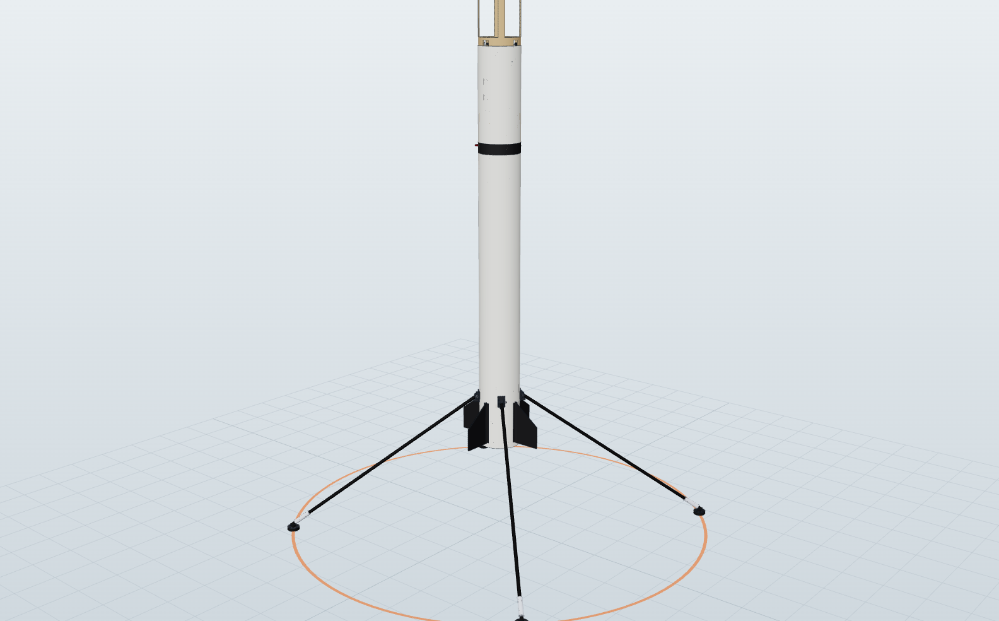

# 7. Landing legs

## 7.1 Requirements

| Requirement | Value | Basis |
|---|---|---|
| Stowed | Flat along the body, < 6 mm proud | Drag and stability on the way up |
| Deploy | Flip down in < 0.3 s at 12 m altitude (~18 m/s, just after the FIRE command, ~1.6 s before touchdown) | Guidance timeline |
| Vertical touchdown | <= 2.5 m/s without bounce | Monte Carlo p95 = 2.3 m/s |
| Lateral touchdown | <= 1.5 m/s without tipping | Monte Carlo p5-p95 = −1.1 to +1.4 m/s |
| Mass | ~100 g for all four, including the release (CAD) | Mass budget, [docs/03](03-vehicle-design.md) |

## 7.2 Geometry (Falcon-9 style)

- **Four legs**, hinged at station 1.40 m (124 mm above the aft end), placed at
  45° between the four fins.
- **Stowed:** each leg (0.58 m from the hinge pin to the foot) lies along the
  body, pointing forward, held by a shared release line. The foot is set
  13 mm off the strut axis so the angled foot clears the tube when stowed.
- **Deployed:** springs swing them aft and outward to **55° from the body
  axis**, where they lock against a printed stop.
  - Hinge pin at radius 57.5 mm. Foot radius R = 0.0575 + 0.581·sin 55° −
    0.013·cos 55° = **0.526 m** (1.05 m tip-to-tip).
  - Feet sit 0.581·cos 55° + 0.013·sin 55° − 0.124 = **0.22 m below the aft
    end**. That clears the nozzles, paddles and lidar, and keeps the motor
    plume off the ground for an instant longer.



**Tip-over check.** Treat the vehicle as a rigid body that pivots about the
outer edge of its footprint at touchdown (angular momentum is conserved at the
impact):

- **Inputs (CAD, end of the burn):** CG height above the feet h = 0.74 m;
  worst-case support distance (between two legs) d = R·cos 45° = 0.37 m;
  m = 1.40 kg; I_cg ≈ 0.27 kg·m² (legs out).
- **Static tip angle:** atan(d/h) = **27°**.
- **Critical lateral speed:**
  v_crit = (I_p·ω_max)/(m·h), with I_p = I_cg + m(h² + d²) and
  ω_max = sqrt(2 m g (sqrt(h² + d²) − h)/I_p). That gives **v_crit ≈ 1.7 m/s**.
  The design limit is 1.5 m/s.

At equal radius, 4 legs give ~40% more tip margin than 3. Rules of thumb:
foot radius ≥ 0.6-0.9 x the CG height, and lateral speed < ~1-1.5 m/s.

## 7.3 Mechanism

```
   body tube                                 deployed (55 deg)
  ===========[hinge]=====|  aft end                \
       leg (stowed) ---> |                          \  leg
                         |                           \
      torsion spring at the hinge                     o  foot (TPU, crush pad)
```

| Part | Design |
|---|---|
| Strut | 8 mm OD x 7 mm ID pultruded carbon tube, 532 mm (~10 g). Euler buckling ~280 N, against ~30 N per leg at touchdown |
| Hinge | CF-nylon or PETG clevis bonded to an internal ply doubler; 3 mm steel pin. The fit matters: too tight and it won't lock, too loose and it breaks ([Apogee Mega Lander notes](https://www.apogeerockets.com/Rocket-Kits/Skill-Level-5-Model-Rocket-Kits/Star-Lift-Mega-Lander)) |
| Spring | Stainless torsion spring at each hinge, ~0.15 N·m preload, or a loop of #64 rubber band like BPS and K-9 |
| Lock | Printed stop at 55° plus a spring-steel detent, so the legs can't fold back on impact |
| Release | All four legs held by one Kevlar loop that passes through a **pin pulled by a micro servo** (reusable, no pyro). Alternative: a nichrome burn wire cutting the loop, as BPS did ([Hackaday](https://hackaday.com/2022/08/05/bps-space-succesfully-lands-a-model-rocket/), [K-9 legs](https://www.printables.com/model/164898-k-9-model-rocket-landing-leg-system-v6)) |
| Damping | 3-5 cm of stroke: a TPU-95A lattice foot (crush pad) **plus** a small syringe or air damper in the strut, like Kapoor's lander ([PopSci](https://www.popsci.com/science/model-rocket-landing/)). Without damping, bounce is what ended BPS's early attempts. |
| Feet | 30 mm TPU discs, angled to sit flat at 55° |

**Energy sizing.** At 2.5 m/s, ½·m·v² = 4.4 J (1.40 kg). Spread over 4 cm of stroke that
averages ~110 N, about 8 g of deceleration. That is gentle on the electronics,
and the BMI088's ±24 g range logs it cleanly.

## 7.4 Tests

1. **Deploy test:** hang the rocket nose-up and release. All 4 legs must lock in
   under 0.3 s, 20 times in a row.
2. **Drop test:** a dummy-mass vehicle at the flight CG, legs out, dropped from
   0.32 m (2.5 m/s) onto grass and onto plywood. Pass: no bounce above 3 cm, no
   damage.
3. **Lateral test:** the same drop with 1.5 m/s of sideways speed (a swing rig
   or a cart). Pass: it does not tip.
4. **Aero check:** watch on the first ascent-only flights that stowed legs
   don't flutter or creep open (onboard camera).
