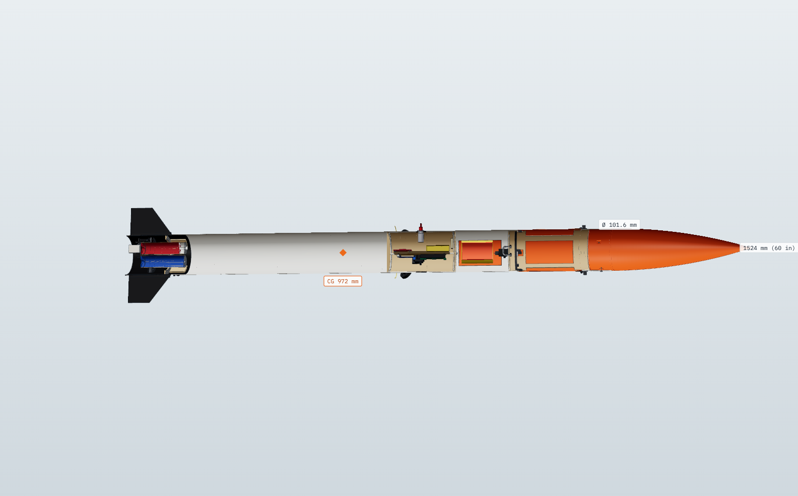
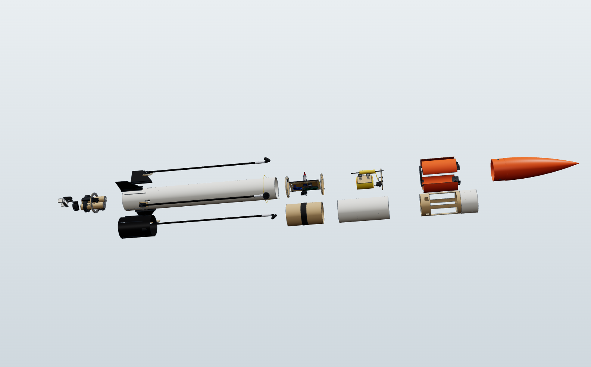
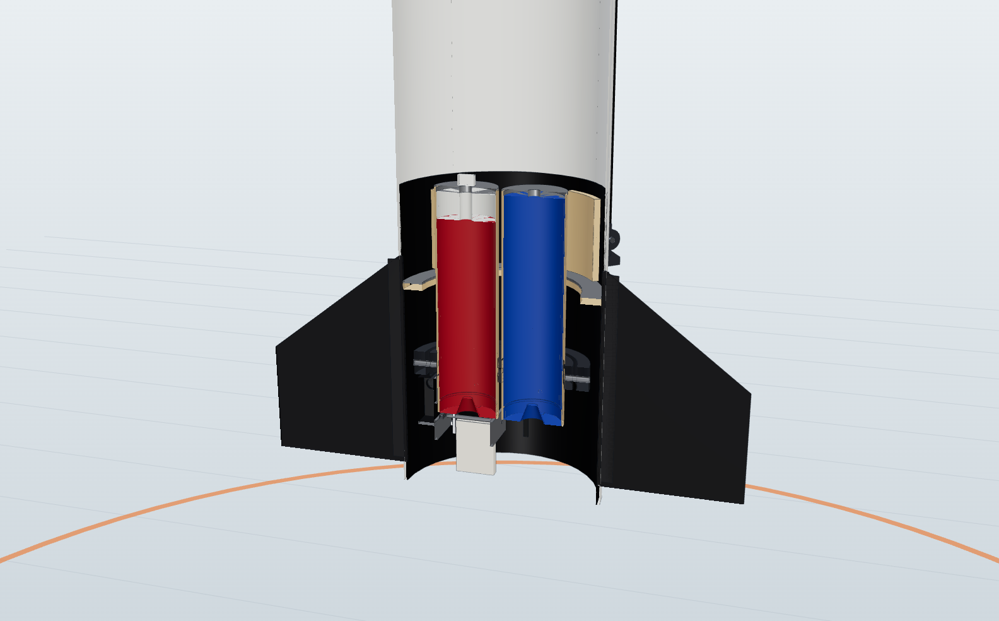
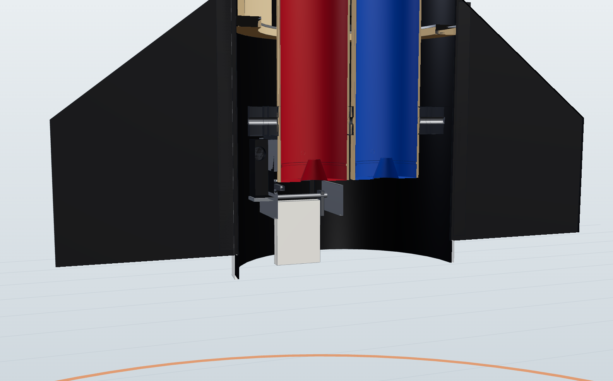
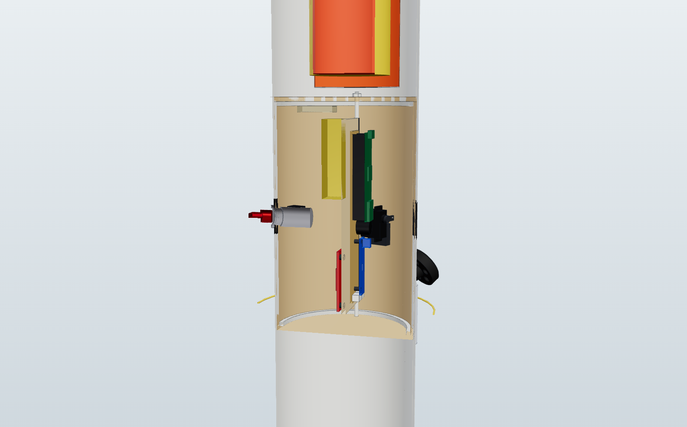
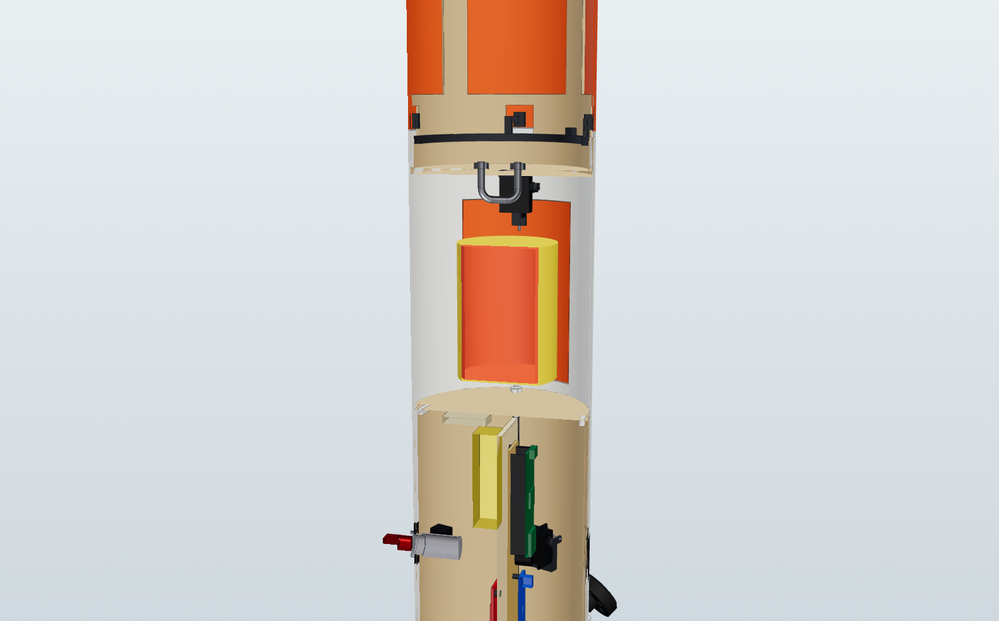

# 13. CAD model



The whole rocket is modelled in 3D, every part to the dimensions in these
docs: 133 different parts, 219 pieces in all. The model is code (CadQuery, a
Python CAD library on the OpenCascade kernel), so a change to one number in
[`cad/slr1/dims.py`](../cad/slr1/dims.py) rebuilds every file below.

**Interactive viewer:** `cad/viewer/index.html` (published privately as the
"SLR-1 CAD Viewer" page). It lets you orbit the model, switch between flight
and landing configurations, explode it, cut it in half, and click any part to
see what it is. Its *Sections* mode steps through each bay with the skin
see-through and every part numbered.

**Section guide:** [docs/14](14-sections.md) has the same X-ray views as still
images, and a card for every part: what it does, what it is made of, and its mass.

## 13.1 What is in the model

| Subassembly | Parts | Pieces | Mass (g) | Highlights |
|---|---:|---:|---:|---|
| Nose | 2 | 4 | 101 | PETG ogive with 2 in shoulder, 3 × M3 retention screws |
| Forward airframe | 2 | 2 | 92 | Nose ring, recovery section with the door cut-out |
| Top airbrakes | 12 | 30 | 114 | 4 petals, fixed and moving hinge halves with 90° stops, pins, torsion springs, latch tabs, latch ring, latch servo + horn + link + mount, windowed sleeve |
| Backup chute bay | 21 | 24 | 125 | Recovery bulkhead and U-bolt, 30 in chute + Nomex, shock cord, ejector plate and springs, door + hinge + latch lug, latch servo, pin and link |
| Avionics bay | 37 | 59 | 261 | Coupler, switch band, lids and locating rings, rods, sled, perfboard, Teensy 4.1, BMI088, BMP390, buck, pyro FETs, capacitor, buzzer, connectors, LiPo, GPS + patch antenna, LoRa + antenna, arm key switch + key, main switch, leg-release servo + pin |
| Aft airframe | 6 | 16 | 349 | Aft tube with fin and leg slots, carbon liner, 4 fins, 8 epoxy fillets, harness and lidar cable |
| Landing legs | 10 | 37 | 102 | Clevis with 55° stop, internal doubler, pin, torsion spring, knuckle insert, strut, syringe damper and plunger, TPU foot (× 4), release loop |
| Motor bay | 25 | 29 | 118 | Sleeves, thrust caps, clip retainers, spacer, inner and middle gimbal rings, yoke posts, 4 gimbal pins, thrust plate (ply + aluminium), 2 servos with horns, pushrods and brackets, lidar + window + bracket, igniter connector |
| Throttle | 16 | 16 | 33 | 2 ceramic paddles, 4 arms, pins, bracket, scissor crosshead and links, servo, horn, link, heat shield |
| Motors | 2 | 2 | 179 | AeroTech F52C and F25W |

## 13.2 Files

Everything is under [`cad/out/`](../cad/out/), regenerated by `python cad/build.py`:

| File | What it is |
|---|---|
| `SLR1_flight.step` | Full assembly, legs stowed and airbrakes closed (pad / ascent) |
| `SLR1_landing.step` | Full assembly, legs at 55° and airbrakes open |
| `parts/*.step` | One STEP per part (133 files), named by part number |
| `stl/*.stl` | The 27 printed parts, ready to slice |
| `dxf/*.dxf` | Flat parts for a laser or CNC: fin, recovery bulkhead, avionics lids, sled, thrust plates |
| `bom.csv` | Part number, description, quantity, material, how to make it, mass, file names |
| `mass_report.md` | Mass, CG and inertia by configuration and budget line; heaviest parts; densities |
| `mass_items.json` | The same budget in the form `sim/rocketsim/designs.py` uses |
| `interference.md` | Clash check of both configurations and the gimbal sweep |
| `viewer/` | Meshes (GLB) and part data for the 3D viewer |



## 13.3 Opening it in SolidWorks

1. **File → Open**, set the file type to *STEP AP203/214/242 (\*.step; \*.stp)*
   and pick `SLR1_flight.step` (or `SLR1_landing.step`).
2. SolidWorks builds an assembly with one sub-assembly per bay (Nose,
   Top_airbrakes, Avionics_bay, Motor_bay...). Each part is a component named
   by its part number, for example `LEG-STRUT-3`. Parts used more than once
   (fins, legs, petals, nuts) are one part file placed several times.
3. Units are millimetres. The origin is on the rocket axis at the aft end of
   the airframe. +Z points to the nose and +X points at fin 1 (marked "N").
   Stations in the docs are measured from the nose tip, so z = 1524 − station.
4. Imported STEP parts are solid bodies without a feature tree. Edit them with
   direct-editing tools (Move/Delete Face). In SolidWorks Premium you can run
   FeatureWorks to recover features, or open the single-part STEP from
   `parts/` and model on top of it.
5. Colours come across with the STEP file.

The parametric source is the Python in [`cad/slr1/`](../cad/slr1/). For a
dimensional change, editing `dims.py` and re-running the build keeps every
part consistent. Editing in SolidWorks is better for detailing one part.

## 13.4 Making the parts

| Process | Parts | Notes |
|---|---|---|
| 3D print, CF-nylon | gimbal rings and posts, servo brackets, petal and door hinges, petal tabs, latch ring, leg clevises and inserts, lidar and servo mounts, spring cups, rod guides | Dry the filament; 4 perimeters; 40-60 % infill for the gimbal rings (the CAD masses assume 70 % of solid); ream pin holes to size |
| 3D print, PETG | nose cone, lid locating rings, F25W spacer | The nose is 375 mm tall with its shoulder. Most printers need it split at ~200 mm and joined with a glued printed sleeve. A LOC plastic nose would add ~47 g and put rev C over 1500 g |
| 3D print, TPU-95A | feet, harness grommet | 30 % gyroid in the feet; they are the crush pads |
| Laser / CNC, 1/8 in ply | `dxf/` files | Fins are 3/32 in aircraft birch; sled is lite ply |
| Cut from tube stock | 5 body-tube pieces, petals, door, couplers, motor sleeves | Lengths in [docs/08](08-build-guide.md); cut the petals and door with a fine saw (1 mm kerf modelled) |
| Machine | ceramic paddles, stainless paddle arms, aluminium paddle bracket and thrust caps | |
| Lay-up | aft carbon liner, epoxy fillets | |
| Buy | electronics, servos, motors, fasteners, springs, chute, cord | See [docs/11](11-bom-and-budget.md); the CAD shapes are envelope models |

## 13.5 What the CAD changed in the design

Building the model in 3D turned up these errors in the rev B paper design. All
are fixed in rev C:

1. **Body length.** A 12.75 in nose plus a 43.5 in tube is only 56.25 in. A
   60 in rocket needs 47.25 in of tube.
2. **Nose shoulder.** A 3.75 in shoulder left no room for the airbrake sleeve to
   reach into the nose ring, so nothing held the nose ring on. Rev C uses a
   2 in shoulder and a sleeve glued 19 mm into the ring.
3. **Gimbal swing.** With the pivot near the aft end of 125 mm sleeves, the
   forward end of the sleeves would hit the tube wall at 7°. Rev C centres
   113 mm sleeves on the pivot and checks the full ±7° sweep in the CAD.
4. **Motor retainers.** Screw-cap retainers are wider than the 33 mm motor
   spacing. Rev C uses spring-steel clips.
5. **Paddles inside the tube.** The paddle pivots now sit 8 mm below the
   nozzles, so the open paddles end 1 mm above the aft end. Closed, they deflect
   the jets out of the open aft end, clear of the tube and fins.
6. **Stowed feet.** The angled feet dug into the tube when stowed. They are now
   offset 13 mm from the strut axis. The footprint is 1.05 m instead of 1.08 m.
7. **Mass.** The real parts weigh about 150 g more than the paper budget, even
   after the weight cuts in [docs/03](03-vehicle-design.md#32-mass-budget-target--1500-g-at-liftoff).
   The CG also moved 4.5 cm forward. Rev C re-balances the fins and petals,
   switches the ascent to the F52C, and re-runs every simulation with the CAD
   mass, CG and inertia.

## 13.6 Checks

- **Interference:** every pair of solids whose bounding boxes touch (~790 pairs
  per configuration) is intersected. There are **0 clashes** in both
  configurations. The only overlaps are 12 designed joints: ball links,
  pushrods and cords drawn seated in the horn, lug or pin they attach to.
- **Gimbal sweep:** the parts the gimbal carries (sleeves, motors, rings,
  paddles and their servo) are tilted to ±7° on each axis and on both axes
  together, and checked against everything fixed. **0 clashes.**
- **Mass properties:** the CAD gives 1472 g, CG at station 970 mm and
  0.247 kg·m² at liftoff. The simulator's item budget reproduces the same
  numbers.

| | |
|---|---|
|  |  |
|  |  |

## 13.7 Rebuilding and changing the design

```bash
pip install cadquery                     # 2.8; pulls in the OpenCascade kernel
python cad/build.py                      # ~3 min: STEP, STL, DXF, viewer, BOM, mass, clash checks
python cad/build.py --quick              # skip the clash checks
```

To change the design:

1. Edit `cad/slr1/dims.py` (or the part functions in `airframe.py`,
   `bays.py`, `propulsion.py` and `legs.py`).
2. Run `python cad/build.py` and read `cad/out/interference.md`.
3. Copy the new `cad/out/mass_items.json` numbers into `SLR1_ITEMS` and
   `MOTOR_STATION_M` in `sim/rocketsim/designs.py`.
4. Re-run the simulator and update `firmware/src/core/params.h`
   ([docs/06](06-gnc.md)).

Still images are rendered from the viewer with
`node cad/tools/render_views.mjs <three-package-dir> <png-dir>`. It needs
Playwright and a local copy of the `three@0.160.0` npm package.

The section guide is rebuilt in two steps. The section list, the part
descriptions and the camera for each view are in
[`cad/slr1/sections.py`](../cad/slr1/sections.py).

```bash
node cad/tools/render_sections.mjs <three-package-dir> docs/img   # X-ray views + 133 part thumbnails (~8 min)
python cad/tools/section_guide.py                                 # writes docs/14-sections.md
```

## 13.8 Limits of the model

- Bought parts (servos, boards, battery, switches, lidar, chute) are envelope
  models with catalogue or estimated masses, not vendor CAD. Check fits against
  your real parts.
- Wiring is drawn as two bundles and two cables. Plan the real routing on the
  bench.
- Threads, epoxy squeeze-out, paint and the fibreglass skin inside the petals
  are not modelled.
- Printed-part masses assume the infill noted per part. Weigh them.
