# 14. Section by section

Every part of SLR-1, bay by bay: 133 parts in 8 sections. Each section has X-ray views
rendered from the CAD, with the outer skin see-through and every part numbered. The numbers match
the table under the views. A dashed leader points to a part hidden behind others.

Masses are from the CAD (catalogue masses for bought parts). *Qty* counts every copy on the rocket.
The same guide is on the project website, and the interactive viewer
([docs/13](13-cad.md)) has a *Sections* mode that draws these callouts live.

- [14.1 Nose cone](#141-nose-cone)
- [14.2 Top airbrakes](#142-top-airbrakes)
- [14.3 Backup chute bay](#143-backup-chute-bay)
- [14.4 Avionics bay](#144-avionics-bay)
- [14.5 Aft airframe and fins](#145-aft-airframe-and-fins)
- [14.6 Landing legs](#146-landing-legs)
- [14.7 Motor bay and TVC gimbal](#147-motor-bay-and-tvc-gimbal)
- [14.8 Exhaust-paddle throttle](#148-exhaust-paddle-throttle)

## 14.1 Nose cone

The printed nose is the top 323 mm of the rocket. It comes off (three screws) so you can reach the airbrake latch.

**2 parts, 4 pieces, 101 g.**

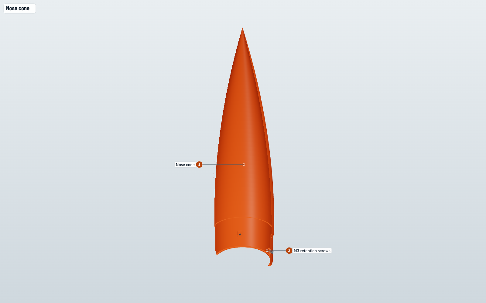

| | # | Part | What it does | Made from | Qty | Mass (g) |
|---|---:|---|---|---|---:|---:|
| 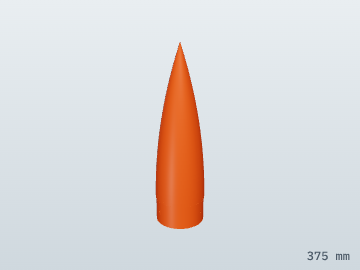 | 1 | **Nose cone** `NOSE-01` | Printed PETG tangent ogive, 0.8 mm wall. Its 2 in shoulder slides into the nose ring. Three printed bosses inside take the retention screws. | Print · PETG | 1 | 99 |
| 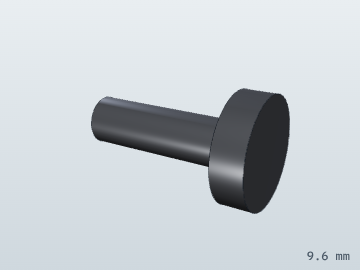 | 2 | **M3 retention screws** `NOSE-SCREW` | Hold the nose on through the nose ring. Take them out to lift the nose off and reach the airbrake latch. | Buy · steel | 3 | 0.5 |

## 14.2 Top airbrakes

Four petals cut from the body tube, just below the nose. At apogee one servo turns a latch ring and springs flip all four out to 90°. Drag at the top keeps the falling rocket tail-down, the way a shuttlecock's feathers keep it cork-first.

**13 parts, 31 pieces, 138 g.**

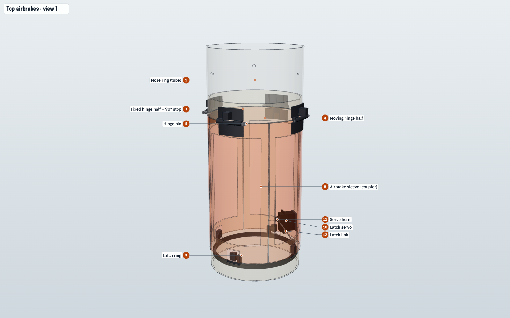

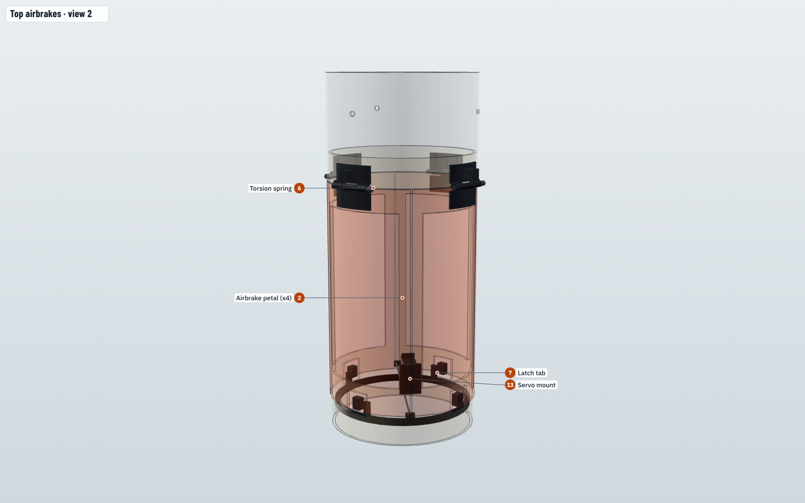

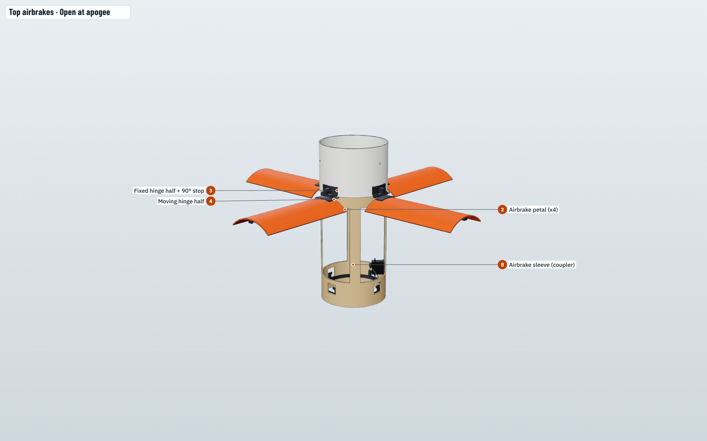

| | # | Part | What it does | Made from | Qty | Mass (g) |
|---|---:|---|---|---|---:|---:|
| 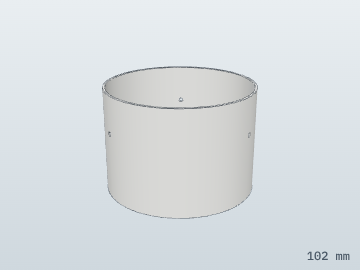 | 1 | **Nose ring (tube)** `TUBE-01` | The 71 mm piece of body tube between the nose and the petals. The fixed hinge halves are bonded to it, and it is glued 19 mm onto the airbrake sleeve. | Cut from tube · kraft phenolic tube | 1 | 24 |
| 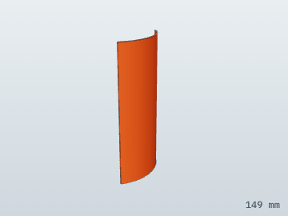 | 2 | **Airbrake petal (x4)** `PETAL-01` | A 90° quadrant cut from the body tube, 150 mm long. Flush with the skin on the way up; springs out to 90° at apogee so the rocket falls tail-first and stable at ~18 m/s. | Cut from tube · kraft phenolic tube | 4 | 12 |
| 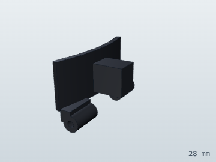 | 3 | **Fixed hinge half + 90° stop** `PETAL-HINGE-F` | Printed CF-nylon leaf bonded to the nose ring with two knuckles. Its stop block catches the open petal at 90° against ~3 N of air load. | Print · CF-nylon | 4 | 1.1 |
| 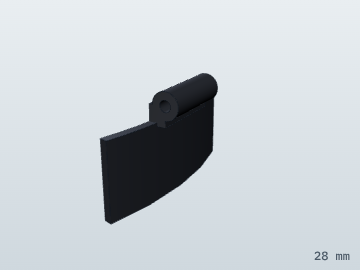 | 4 | **Moving hinge half** `PETAL-HINGE-M` | Printed CF-nylon leaf bonded to the petal's forward edge; its middle knuckle turns on the hinge pin. | Print · CF-nylon | 4 | 0.6 |
| 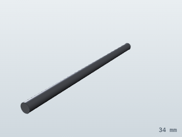 | 5 | **Hinge pin** `PETAL-PIN` | 1.6 mm stainless pin through the three knuckles; it also carries the torsion spring. | Buy · steel | 4 | 0.5 |
| 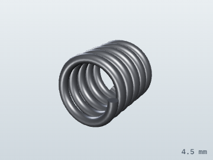 | 6 | **Torsion spring** `PETAL-SPRING` | About 0.1 N·m of preload that flips the petal open in under 0.2 s when the latch lets go. | Buy · steel | 4 | 0.1 |
| 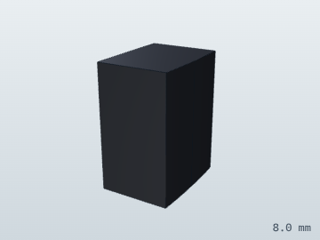 | 7 | **Latch tab** `PETAL-TAB` | Printed tab bonded inside the petal's aft edge. It pokes through the sleeve slot, and its notch is where the latch-ring finger sits. | Print · CF-nylon | 4 | 0.2 |
| 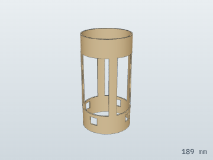 | 8 | **Airbrake sleeve (coupler)** `CPL-01` | 189 mm LOC coupler that holds the nose ring and the recovery section together across the petal band. Windows under each petal save 33 g; slots let the petal tabs through. | Cut from tube · kraft coupler tube | 1 | 43 |
| 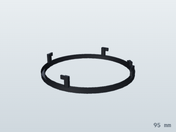 | 9 | **Latch ring** `LATCH-RING` | Printed ring inside the sleeve with one finger per petal. Turning it a few degrees slides all four fingers out of the tab notches at once. | Print · CF-nylon | 1 | 5.2 |
| 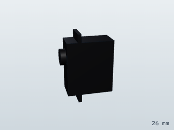 | 10 | **Latch servo** `SERVO-LATCH` | 4.3 g micro servo (pin 7) that turns the latch ring at apogee. | Buy · servo | 1 | 4.3 |
| 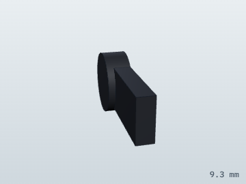 | 11 | **Servo horn** `HORN-LATCH` | Arm on the latch servo's output shaft. | Buy · CF-nylon | 1 | 0.3 |
| 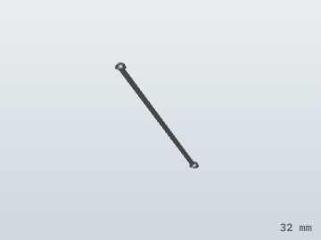 | 12 | **Latch link** `LATCH-LINK` | Wire link with ball ends from the horn to the latch ring's lug. | Buy · steel | 1 | 0.3 |
| 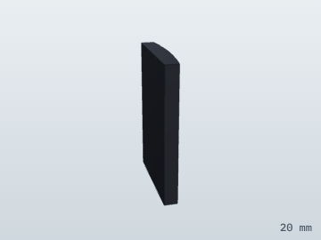 | 13 | **Servo mount** `LATCH-SERVO-BRKT` | Printed block that bonds the latch servo to the solid strip of sleeve between two windows. | Print · CF-nylon | 1 | 0.7 |

## 14.3 Backup chute bay

Abort-only recovery. A servo pulls a pin, the door swings open and two springs push the 30 in chute out. In a normal flight this bay never opens.

**22 parts, 25 pieces, 193 g.**

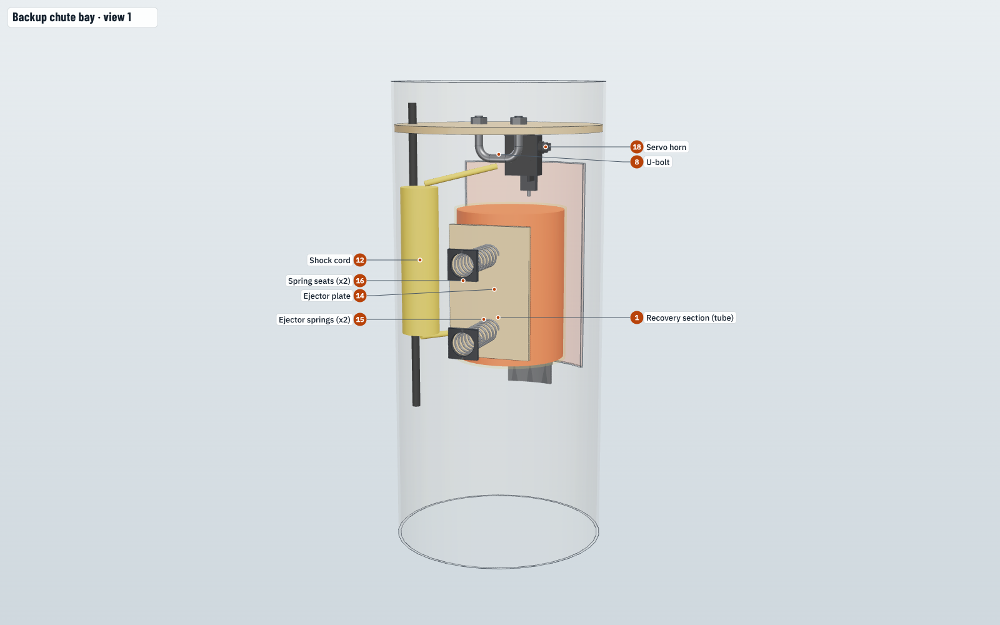

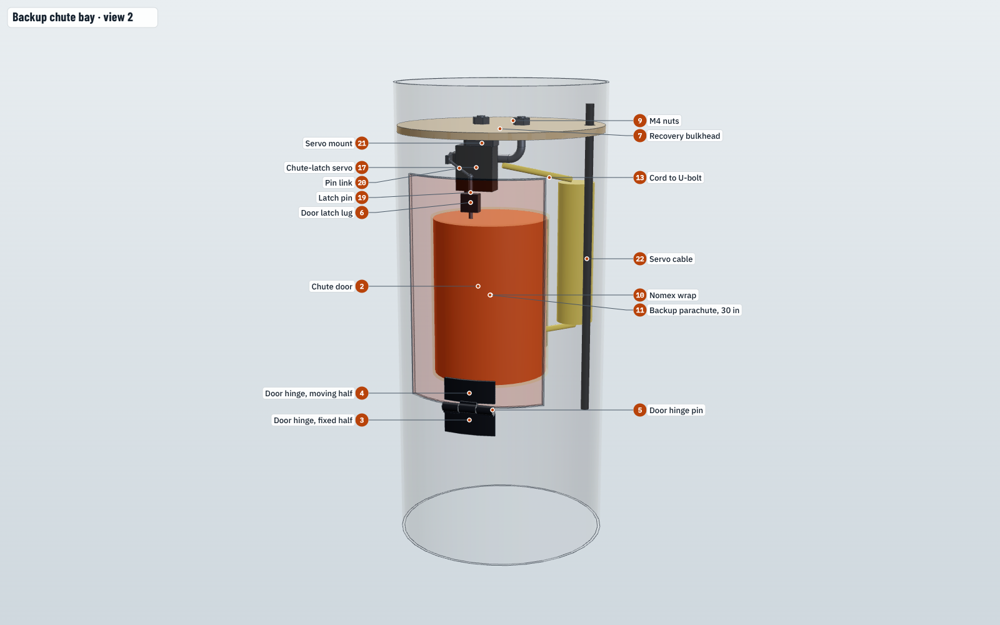

| | # | Part | What it does | Made from | Qty | Mass (g) |
|---|---:|---|---|---|---:|---:|
| 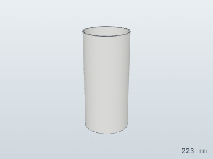 | 1 | **Recovery section (tube)** `TUBE-02` | 223 mm of body tube between the petals and the avionics bay. It holds the chute bay and has the door cut out of it. | Cut from tube · kraft phenolic tube | 1 | 68 |
| 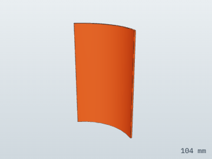 | 2 | **Chute door** `DOOR-01` | 105 x 70 mm panel cut from the tube. It is latched shut in a normal flight; in an abort it swings open and the chute is pushed out. | Cut from tube · kraft phenolic tube | 1 | 7.6 |
| 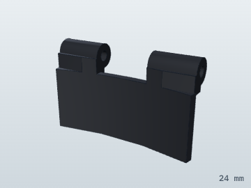 | 3 | **Door hinge, fixed half** `DOOR-HINGE-F` | Printed hinge leaf on the tube at the door's aft edge. | Print · CF-nylon | 1 | 0.6 |
| 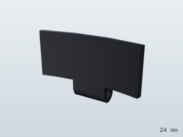 | 4 | **Door hinge, moving half** `DOOR-HINGE-M` | Printed hinge leaf on the door. | Print · CF-nylon | 1 | 0.5 |
|  | 5 | **Door hinge pin** `DOOR-PIN` | 1.6 mm stainless pin through the door hinge. | Buy · steel | 1 | 0.4 |
| 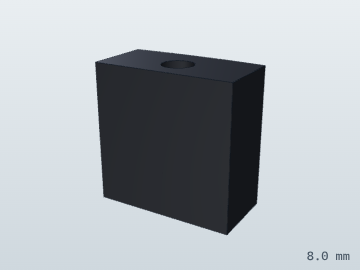 | 6 | **Door latch lug** `DOOR-LUG` | Printed lug inside the door's forward edge; the chute-latch pin passes through it to hold the door shut. | Print · CF-nylon | 1 | 0.3 |
| 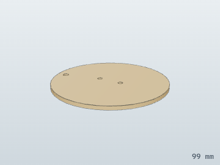 | 7 | **Recovery bulkhead** `RECOV-BH` | 1/8 in ply disc glued in the tube at the top of the chute bay. It carries the U-bolt and separates the bay from the airbrake sleeve. | Cut · birch ply | 1 | 17 |
| 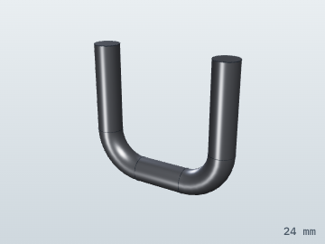 | 8 | **U-bolt** `UBOLT` | M4 U-bolt: the strong point the shock cord and chute hang from. | Buy · steel | 1 | 8.0 |
| 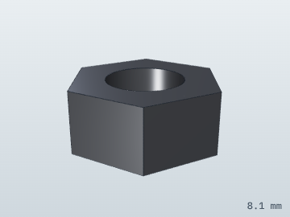 | 9 | **M4 nuts** `NUT-M4` | Clamp the U-bolt to the bulkhead. | Buy · steel | 2 | 1.2 |
| 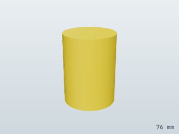 | 10 | **Nomex wrap** `CHUTE-NOMEX` | Fire-resistant blanket wrapped around the folded chute, in case the motors' heat reaches it. | Buy · Nomex | 1 | 14 |
| 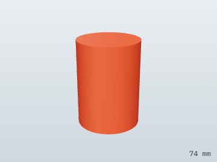 | 11 | **Backup parachute, 30 in** `CHUTE-30` | Nylon chute, Z-folded to about 54 x 74 mm. Used only in an abort; it brings 1.4 kg down at about 5-6 m/s. | Buy · ripstop nylon | 1 | 42 |
| 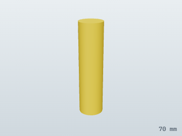 | 12 | **Shock cord** `SHOCK-CORD` | 4.5 m of Kevlar, flaked and bundled. It absorbs the snatch when the chute opens. | Buy · Kevlar | 1 | 14 |
| 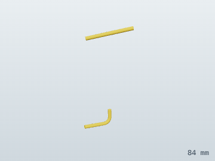 | 13 | **Cord to U-bolt** `SHOCK-CORD-RUN` | The ends of the shock cord: one tied to the U-bolt, one to the chute's riser. | Buy · Kevlar | 1 | 2.0 |
| 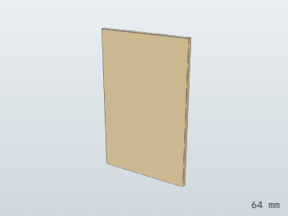 | 14 | **Ejector plate** `EJECT-PLATE` | Thin ply plate on two springs that pushes the chute pack toward the door. | Cut · birch ply | 1 | 3.5 |
| 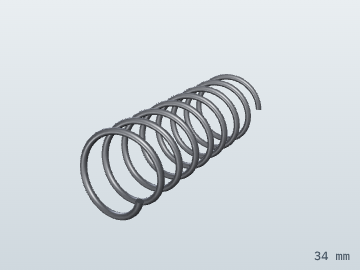 | 15 | **Ejector springs (x2)** `EJECT-SPRING` | Compression springs, ~20 N each, that throw the chute out when the door opens. | Buy · steel | 2 | 1.5 |
| 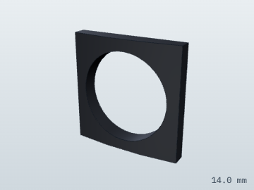 | 16 | **Spring seats (x2)** `EJECT-CUP` | Printed cups bonded to the far wall that locate the ejector springs. | Print · CF-nylon | 2 | 0.2 |
| 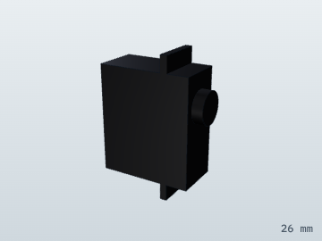 | 17 | **Chute-latch servo** `SERVO-CHUTE` | 4.3 g micro servo (pin 29) under the bulkhead. It pulls the latch pin to open the door. | Buy · servo | 1 | 4.3 |
| 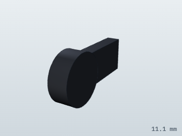 | 18 | **Servo horn** `HORN-CHUTE` | Arm on the chute-latch servo. | Buy · CF-nylon | 1 | 0.3 |
| 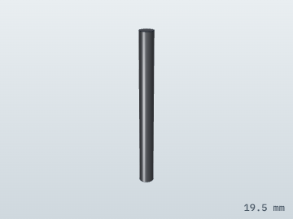 | 19 | **Latch pin** `CHUTE-PIN` | 1.8 mm steel pin through the door lug. Pulling it releases the door. | Buy · steel | 1 | 0.4 |
| 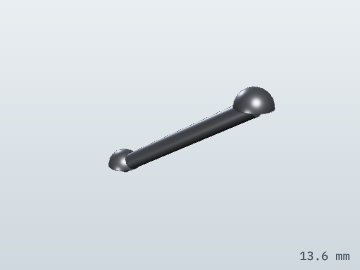 | 20 | **Pin link** `CHUTE-LINK` | Wire link from the servo horn to the latch pin. | Buy · steel | 1 | 0.4 |
| 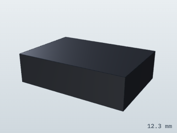 | 21 | **Servo mount** `CHUTE-SERVO-BRKT` | Printed block that bonds the servo to the bulkhead. | Print · CF-nylon | 1 | 0.4 |
| 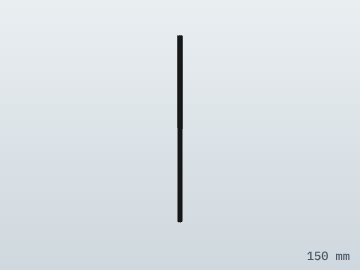 | 22 | **Servo cable** `CABLE-FWD` | Runs the airbrake-latch and chute-latch servo leads up from the avionics bay through the bulkhead. | Buy · electronics | 1 | 4.0 |

## 14.4 Avionics bay

The flight computer, sensors, radio and battery on a sled that slides out. The switch band around the middle carries the arm key, the power switch, the static ports and the leg-release pin.

**37 parts, 59 pieces, 261 g.**

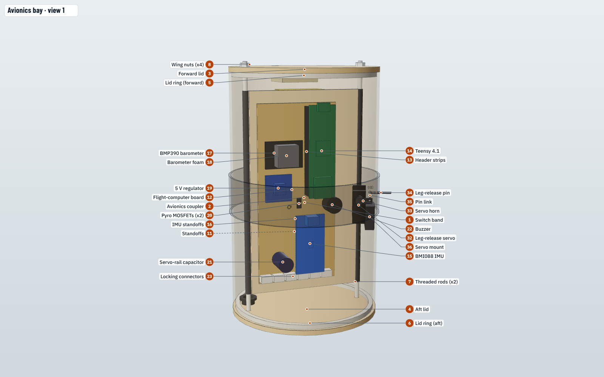

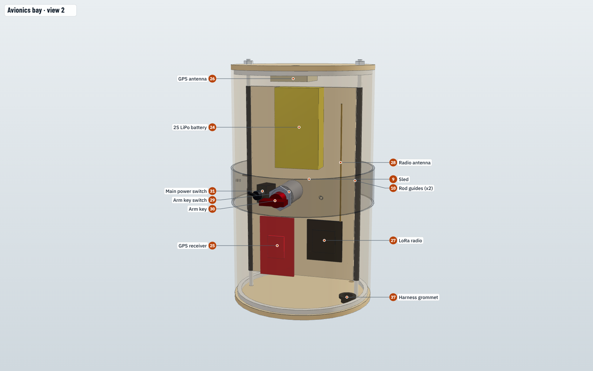

| | # | Part | What it does | Made from | Qty | Mass (g) |
|---|---:|---|---|---|---:|---:|
| 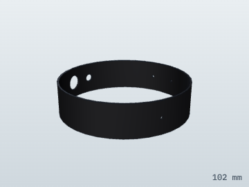 | 1 | **Switch band** `TUBE-03` | 25 mm ring of body tube glued around the middle of the avionics coupler. It carries the arm key, main switch, leg-release pin and three static ports. | Cut from tube · kraft phenolic tube | 1 | 8.3 |
| 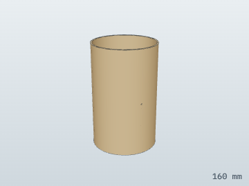 | 2 | **Avionics coupler** `CPL-02` | 160 mm LOC coupler that is the avionics bay. It joins the recovery section to the aft tube. | Cut from tube · kraft coupler tube | 1 | 74 |
| 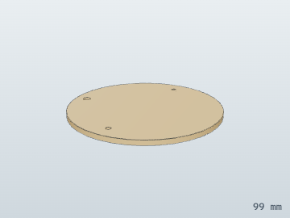 | 3 | **Forward lid** `AV-LID-F` | 1/8 in ply disc that closes the top of the bay; the GPS patch hangs under it. | Cut · birch ply | 1 | 17 |
| 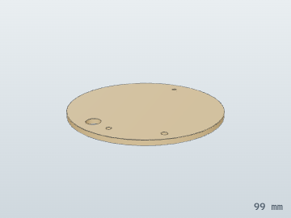 | 4 | **Aft lid** `AV-LID-A` | 1/8 in ply disc that closes the bottom of the bay, with the harness grommet and lidar-cable hole. | Cut · birch ply | 1 | 16 |
| 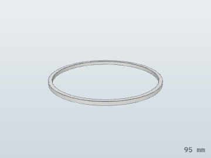 | 5 | **Lid ring (forward)** `AV-LID-RING-F` | Printed ring that keys the forward lid into the coupler. | Print · PETG | 1 | 3.2 |
| 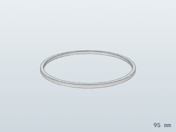 | 6 | **Lid ring (aft)** `AV-LID-RING-A` | Printed ring that keys the aft lid into the coupler. | Print · PETG | 1 | 3.2 |
|  | 7 | **Threaded rods (x2)** `AV-ROD` | M3 nylon rods that clamp the two lids to the coupler and guide the sled. | Buy · CF-nylon | 2 | 1.4 |
|  | 8 | **Wing nuts (x4)** `NUT-M3` | Nylon wing nuts on the rod ends; finger-tight so the bay opens on the field. | Buy · CF-nylon | 4 | 0.2 |
|  | 9 | **Sled** `AV-SLED` | 1/8 in lite-ply board everything electronic mounts to. It slides out on the rods. | Cut · lite ply | 1 | 15 |
|  | 10 | **Rod guides (x2)** `AV-SLED-TUBE` | Printed tubes along the sled edges that ride on the threaded rods. | Print · CF-nylon | 2 | 0.7 |
|  | 11 | **Standoffs** `STANDOFF-3` | 3 mm nylon spacers under the boards. | Buy · CF-nylon | 12 | 0.1 |
|  | 12 | **Flight-computer board** `PERFBOARD` | 54 x 120 mm perfboard carrying the Teensy, sensors, regulator and pyro channels. Becomes a PCB once the design is frozen. | Buy · perfboard | 1 | 19 |
|  | 13 | **Header strips** `HEADERS` | Sockets the Teensy plugs into, so it can be swapped. | Buy · electronics | 1 | 2.0 |
|  | 14 | **Teensy 4.1** `TEENSY-41` | The flight computer: a 600 MHz microcontroller that runs the 1 kHz state estimator and re-plans the landing burn 50 times a second, logging everything to its microSD card. | Buy · circuit board | 1 | 6.0 |
|  | 15 | **BMI088 IMU** `IMU-BMI088` | Accelerometer (±24 g) and gyro. Mounted near the rocket's axis so it reads attitude and acceleration cleanly. | Buy · circuit board | 1 | 3.0 |
|  | 16 | **IMU standoffs** `STANDOFF-5` | Four 5 mm standoffs that mount the IMU rigidly. | Buy · CF-nylon | 1 | 0.3 |
|  | 17 | **BMP390 barometer** `BARO-BMP390` | Measures air pressure for altitude through the whole flight, through the static ports. | Buy · circuit board | 1 | 1.5 |
|  | 18 | **Barometer foam** `BARO-FOAM` | Open-cell foam that shields the barometer from gusts and light. | Buy · foam | 1 | 0.1 |
|  | 19 | **5 V regulator** `BUCK-5V` | Steps the 2S battery down to 5 V for the Teensy, lidar and micro servos. | Buy · circuit board | 1 | 3.0 |
|  | 20 | **Pyro MOSFETs (x2)** `FET-AO3400` | Switch the two landing-motor igniters, fired together. | Buy · electronics | 2 | 0.1 |
|  | 21 | **Servo-rail capacitor** `CAP-1000U` | 1000 µF reservoir that keeps servo current spikes from browning out the computer. | Buy · electronics | 1 | 3.0 |
|  | 22 | **Buzzer** `BUZZER` | Beeps the arm state and status on the pad and helps you find the rocket. | Buy · electronics | 1 | 2.0 |
|  | 23 | **Locking connectors** `JST-GH` | JST-GH headers for servos, sensors and the pyro leads; they can't shake loose. | Buy · electronics | 6 | 0.3 |
|  | 24 | **2S LiPo battery** `LIPO-2S` | 450 mAh, 7.4 V pack that powers everything for about 15 minutes of pad time. | Buy · LiPo | 1 | 30 |
|  | 25 | **GPS receiver** `GPS-M9N` | u-blox NEO-M9N; gives the sideways velocity the landing burn cancels. | Buy · circuit board | 1 | 6.0 |
|  | 26 | **GPS antenna** `GPS-PATCH` | 25 mm ceramic patch under the forward lid, facing the sky. | Buy · ceramic | 1 | 9.0 |
|  | 27 | **LoRa radio** `LORA-RFM95W` | 915 MHz telemetry link to the ground station. | Buy · circuit board | 1 | 3.0 |
|  | 28 | **Radio antenna** `LORA-ANT` | 82 mm quarter-wave wire antenna. | Buy · brass | 1 | 0.5 |
|  | 29 | **Arm key switch** `ARM-KEY-SW` | Physical switch in the igniter power line. Key out means the landing motor cannot fire, whatever the software does. | Buy · electronics | 1 | 12 |
|  | 30 | **Arm key** `ARM-KEY` | Removable key; it goes in only at the pad. | Buy · steel | 1 | 4.0 |
|  | 31 | **Main power switch** `MAIN-SW` | Turns the flight computer on. | Buy · electronics | 1 | 4.0 |
|  | 32 | **Leg-release servo** `SERVO-LEGPIN` | 4.3 g micro servo (pin 28) that pulls the leg-release pin at 12 m. | Buy · servo | 1 | 4.3 |
|  | 33 | **Servo horn** `HORN-LEGPIN` | Arm on the leg-release servo. | Buy · CF-nylon | 1 | 0.3 |
|  | 34 | **Leg-release pin** `LEG-RELEASE-PIN` | 1.5 mm steel pin poking out of the switch band. The Kevlar loop that holds the folded legs hooks over it. | Buy · steel | 1 | 0.2 |
|  | 35 | **Pin link** `LEGPIN-LINK` | Wire link from the servo horn to the release pin. | Buy · steel | 1 | 0.3 |
|  | 36 | **Servo mount** `LEGPIN-BRKT` | Printed block that bonds the leg-release servo to the coupler wall. | Print · CF-nylon | 1 | 1.9 |
|  | 37 | **Harness grommet** `GROMMET` | Printed TPU grommet where the servo and pyro wiring leaves the bay. | Print · TPU-95A | 1 | 0.3 |

## 14.5 Aft airframe and fins

The long aft tube carries the fins and the legs, and the wiring from the avionics bay runs down its wall to the motor bay. A carbon liner stiffens the last 6 in.

**6 parts, 16 pieces, 349 g.**

| | # | Part | What it does | Made from | Qty | Mass (g) |
|---|---:|---|---|---|---:|---:|
|  | 1 | **Aft tube** `TUBE-04` | 731 mm of body tube from the avionics bay to the tail. Slotted for the fins and leg clevises. | Cut from tube · kraft phenolic tube | 1 | 245 |
|  | 2 | **Carbon liner** `LINER-AFT` | Two wraps of carbon cloth inside the last 6 in. They stiffen the tube where the fins, legs and thrust plate load it. | Lay up · carbon fibre | 1 | 35 |
|  | 3 | **Fin (x4)** `FIN-01` | 3/32 in birch ply, through the wall. Keeps the rocket pointed while it coasts up with the motor out. | Cut · birch ply | 4 | 9.3 |
|  | 4 | **Epoxy fillets (x8)** `FIN-FILLET` | 6 mm epoxy fillets on both sides of each fin root; they make the joint strong. | Lay up · epoxy | 8 | 1.1 |
|  | 5 | **Wiring harness** `HARNESS-AFT` | Servo and pyro wiring from the avionics bay down the tube wall to the motor bay. | Buy · electronics | 1 | 18 |
|  | 6 | **Lidar cable** `CABLE-LIDAR` | Runs from the avionics bay to the lidar along the 315° leg line. | Buy · electronics | 1 | 5.0 |

## 14.6 Landing legs

Four carbon legs fold flat along the body for flight. At 12 m a servo pulls one pin, the Kevlar loop lets go, and springs swing all four out to 55°, where a stop and a detent lock them.

**10 parts, 37 pieces, 102 g.**

| | # | Part | What it does | Made from | Qty | Mass (g) |
|---|---:|---|---|---|---:|---:|
|  | 1 | **Hinge clevis + 55° stop** `LEG-CLEVIS` | Printed CF-nylon bracket bonded through a slot in the tube. Its cheeks hold the hinge pin, and its stop block catches the leg at 55°. | Print · CF-nylon | 4 | 3.5 |
|  | 2 | **Doubler** `LEG-DOUBLER` | 1/8 in ply pad inside the tube that the clevis tongue bonds to, spreading the landing load. | Cut · birch ply | 4 | 2.2 |
|  | 3 | **Hinge pin** `LEG-PIN` | 3 mm steel pin the leg pivots on. | Buy · steel | 4 | 1.2 |
|  | 4 | **Torsion spring** `LEG-SPRING` | About 0.15 N·m that swings the leg out in under 0.3 s once released. | Buy · steel | 4 | 0.5 |
|  | 5 | **Knuckle insert** `LEG-INSERT` | Printed knuckle around the pin, with a plug bonded into the strut. | Print · CF-nylon | 4 | 1.2 |
|  | 6 | **Strut** `LEG-STRUT` | 532 mm of 8 x 7 mm pultruded carbon tube. | Cut · carbon fibre | 4 | 9.7 |
|  | 7 | **Damper barrel** `LEG-DAMPER` | Syringe-style air damper bonded to the strut tip. It soaks up the touchdown so the rocket doesn't bounce. | Buy · polycarbonate | 4 | 2.5 |
|  | 8 | **Damper plunger** `LEG-PLUNGER` | Piston and rod that slide in the damper and carry the foot. | Buy · steel | 4 | 1.2 |
|  | 9 | **Foot** `LEG-FOOT` | 30 mm TPU lattice pad, angled to sit flat at 55°; it also crushes to absorb energy. | Print · TPU-95A | 4 | 3.4 |
|  | 10 | **Release loop** `LEG-LOOP` | Kevlar loop around all four folded legs, hooked over the release pin. Pulling the pin lets all four legs swing out together. | Buy · Kevlar | 1 | 0.8 |

## 14.7 Motor bay and TVC gimbal

Both motors sit side by side in one 2-axis gimbal centred on its pivot. Two servos tilt it up to 7° each way to steer the thrust. All thrust flows from the sleeve caps through the rings and pins into the thrust plate.

**27 parts, 31 pieces, 297 g.**

| | # | Part | What it does | Made from | Qty | Mass (g) |
|---|---:|---|---|---|---:|---:|
|  | 1 | **F52C ascent motor** `MOTOR-F52C` | AeroTech F52C, 66 N·s. Lit by the launch controller; flies the rocket to ~226 ft. | Buy · AeroTech motor | 1 | 81 |
|  | 2 | **F25W landing motor** `MOTOR-F25W` | AeroTech F25W, 71 N·s. Lit by the flight computer at ~15 m on the way down; its thrust fades naturally ('strong, then simmer'). | Buy · AeroTech motor | 1 | 97 |
|  | 3 | **F25W spacer** `F25W-SPACER` | 13 mm printed spacer so both nozzles end at the same height (the F25W is shorter). | Print · PETG | 1 | 4.1 |
|  | 4 | **Motor sleeve (x2)** `SLEEVE-29` | 113 mm kraft motor tube bonded into the inner gimbal ring; the motors slide in from the bottom. | Cut from tube · kraft coupler tube | 2 | 8.1 |
|  | 5 | **Thrust cap (x2)** `SLEEVE-CAP` | Aluminium cap on the top of each sleeve. The motor pushes on it, and the igniter leads pass through its hole. | Machine · aluminium | 2 | 5.4 |
|  | 6 | **Clip retainer (ascent)** `CLIP-RET` | Spring-steel clip that hooks under the motor's aft end so it can't slide out. | Bend · steel | 1 | 1.5 |
|  | 7 | **Clip retainer (landing)** `CLIP-RET-L` | Same clip on the landing-motor sleeve. | Bend · steel | 1 | 1.5 |
|  | 8 | **Igniter connector** `IGN-CONN` | Locking 2-pin connector for the landing igniters; it stays unplugged until the pad. | Buy · electronics | 1 | 0.5 |
|  | 9 | **Inner gimbal ring** `GIMBAL-INNER` | Holds both sleeves. Tilts about the X axis on the X pins; servo B drives it. | Print · CF-nylon | 1 | 9.7 |
|  | 10 | **Middle gimbal ring** `GIMBAL-MIDDLE` | Carries the inner ring. Tilts about the Y axis on the Y pins; servo A drives it. | Print · CF-nylon | 1 | 13 |
|  | 11 | **Yoke post (+Y)** `GIMBAL-POST` | Fixed post from the thrust plate that holds one Y pin. | Print · CF-nylon | 1 | 6.1 |
|  | 12 | **Yoke post (−Y)** `GIMBAL-POST-B` | The matching post on the other side. | Print · CF-nylon | 1 | 6.1 |
|  | 13 | **X pins (x2)** `PIN-X` | 3 mm steel pivots between the inner and middle rings. | Buy · steel | 2 | 0.7 |
|  | 14 | **Y pins (x2)** `PIN-Y` | 3 mm steel pivots between the middle ring and the yoke posts. | Buy · steel | 2 | 1.0 |
|  | 15 | **Thrust plate (ply)** `THRUST-PLATE` | 1/8 in ply ring bonded in the tube. All motor thrust ends up here and goes into the airframe. | Cut · birch ply | 1 | 6.0 |
|  | 16 | **Thrust plate (aluminium)** `THRUST-PLATE-AL` | 1 mm aluminium ring on the ply that spreads the post and servo loads. | Cut · aluminium | 1 | 7.5 |
|  | 17 | **Gimbal servo A** `SERVO-GIMBAL-A` | KST X08H (pin 2) that tilts the middle ring: pitch. | Buy · servo | 1 | 8.0 |
|  | 18 | **Servo horn A** `HORN-GIMBAL-A` | 10 mm horn, about a 2:1 servo-to-gimbal ratio. | Buy · CF-nylon | 1 | 0.4 |
|  | 19 | **Pushrod A** `PUSHROD-A` | 1.5 mm steel rod with ball links from servo A to the middle-ring lug. | Buy · steel | 1 | 1.2 |
|  | 20 | **Servo bracket A** `SERVO-BRKT-A` | Printed bracket on the thrust plate. | Print · CF-nylon | 1 | 1.1 |
|  | 21 | **Gimbal servo B** `SERVO-GIMBAL-B` | KST X08H (pin 3) that tilts the inner ring: yaw. | Buy · servo | 1 | 8.0 |
|  | 22 | **Servo horn B** `HORN-GIMBAL-B` | 10 mm horn. | Buy · CF-nylon | 1 | 0.4 |
|  | 23 | **Pushrod B** `PUSHROD-B` | Ball-link rod from servo B to the inner-ring lug. | Buy · steel | 1 | 1.2 |
|  | 24 | **Servo bracket B** `SERVO-BRKT-B` | Printed bracket on the thrust plate. | Print · CF-nylon | 1 | 1.1 |
|  | 25 | **Lidar** `LIDAR-TFMINI` | Benewake TFmini-S looking straight down; measures the last ~7 m to the ground and detects touchdown. | Buy · electronics | 1 | 5.0 |
|  | 26 | **Lidar window** `LIDAR-WINDOW` | Replaceable 1 mm polycarbonate shield that keeps exhaust soot off the lidar's lenses. Wipe it after every flight. | Cut · polycarbonate | 1 | 0.8 |
|  | 27 | **Lidar bracket** `LIDAR-BRKT` | Printed bracket on the liner at 315°, clear of both plumes and the paddles; its lip holds the window. | Print · CF-nylon | 1 | 4.5 |

## 14.8 Exhaust-paddle throttle

A solid motor can't be throttled, so two ceramic paddles under the landing motor swing into its exhaust and deflect part of the thrust sideways. One servo drives both through a scissor linkage, so the side forces cancel.

**16 parts, 16 pieces, 33 g.**

| | # | Part | What it does | Made from | Qty | Mass (g) |
|---|---:|---|---|---|---:|---:|
|  | 1 | **Paddle (+Y)** `PADDLE-R` | Machinable ceramic, 20 x 28 x 4 mm. Swings into the landing motor's exhaust to deflect up to 75 % of its thrust sideways: the throttle. | Machine · ceramic | 1 | 5.2 |
|  | 2 | **Paddle (−Y)** `PADDLE-L` | Its twin on the other side, so the two side forces cancel. | Machine · ceramic | 1 | 5.2 |
|  | 3 | **Outboard arm + lever (+Y)** `PADDLE-ARM-OR` | 1.5 mm stainless arm that holds the paddle; its lever is what the scissor link pushes. | Machine · steel | 1 | 0.7 |
|  | 4 | **Outboard arm + lever (−Y)** `PADDLE-ARM-OL` | Same, other paddle. | Machine · steel | 1 | 0.7 |
|  | 5 | **Inboard arm (+Y)** `PADDLE-ARM-IR` | Second stainless arm on the paddle's other end. | Machine · steel | 1 | 0.6 |
|  | 6 | **Inboard arm (−Y)** `PADDLE-ARM-IL` | Same, other paddle. | Machine · steel | 1 | 0.6 |
|  | 7 | **Pivot pin (+Y)** `PADDLE-PIN-R` | 2 mm steel pin the paddle swings on, 8 mm below the nozzle. | Buy · steel | 1 | 0.8 |
|  | 8 | **Pivot pin (−Y)** `PADDLE-PIN-L` | Same, other paddle. | Buy · steel | 1 | 0.8 |
|  | 9 | **Paddle bracket** `PADDLE-BRKT` | 1.5 mm aluminium U-bracket under the inner gimbal ring, so the paddles move with the motor. | Machine · aluminium | 1 | 8.0 |
|  | 10 | **Scissor crosshead** `PADDLE-XHEAD` | Slides up and down. Through the two links it opens or closes both paddles together. | Machine · steel | 1 | 0.4 |
|  | 11 | **Scissor link (+Y)** `PADDLE-LINK-R` | Link from the crosshead to the +Y paddle lever. | Buy · steel | 1 | 0.3 |
|  | 12 | **Scissor link (−Y)** `PADDLE-LINK-L` | Link to the −Y paddle lever. | Buy · steel | 1 | 0.3 |
|  | 13 | **Throttle servo** `SERVO-PADDLE` | KST X08H (pin 4) strapped to the bracket. It moves the crosshead 50 times a second to follow the burn plan. | Buy · servo | 1 | 8.0 |
|  | 14 | **Servo horn** `HORN-PADDLE` | 10 mm horn on the throttle servo. | Buy · CF-nylon | 1 | 0.4 |
|  | 15 | **Servo link** `PADDLE-SERVO-LINK` | Link from the horn to the crosshead, through a slot in the bracket. | Buy · steel | 1 | 0.3 |
|  | 16 | **Heat shield** `HEAT-SHIELD` | Aluminium plus ceramic paper under the servo, between it and the plume. | Cut · aluminium | 1 | 0.5 |

---

Generated by `python cad/tools/section_guide.py` from `cad/slr1/sections.py` and the CAD build.
Images: `node cad/tools/render_sections.mjs <three-package-dir> docs/img` ([docs/13](13-cad.md#137-rebuilding-and-changing-the-design)).
